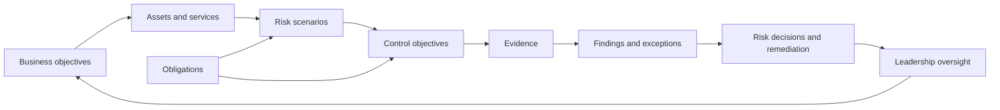

# GRC architecture and information model

## Purpose

GRC architecture connects business objectives, assets, obligations, risks, controls, evidence, findings, and decisions. It creates traceability to support management and assurance decisions.

## Conceptual model

## Core records

- Business service and criticality
- Asset, data, and supplier inventory
- Obligation register
- Risk scenario register
- Control ownership and objective mapping
- Evidence items and tests
- Findings, action plans, and exceptions
- GRC metrics and decision logs

## Platform design

Use an authoritative record source for each object type. Integrate with asset, IAM, change, incident, vulnerability, procurement, and evidence systems only where the value is clear and access is controlled.

## Data governance rules

- Maintain explicit owners and review dates
- Classify records and evidence
- Apply least privilege and retention rules
- Track source and verification status
- Preserve audit history for decisions and actions

## Design principles

1. Risk and business context before framework checklists
2. Reuse trusted evidence with provenance
3. Separate authorship, review, and approval
4. Report uncertainty and limitations honestly
