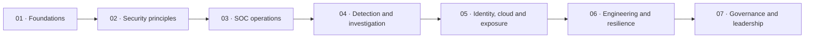

# 🛡️ Cybersecurity Roadmap 2026–2027

### A practical learning path from security foundations to enterprise leadership

**UNDERSTAND THE RISK · BUILD THE CONTROL · MEASURE THE OUTCOME**

 

**A structured, hands-on reference for learning, building, and communicating security capability.**

[Start learning](#-start-here) · [Browse all 38 guides](#-the-complete-38-guide-roadmap) · [CISO view](#-the-ciso-and-security-leadership-view) · [Tools](#-defensive-tools-and-platforms) · [Governance](#-governance-risk--compliance)

> [!IMPORTANT]
> **Educational and defensive use only.** Work only with systems, data, and environments you own or are explicitly authorized to assess. Use isolated labs and approved training environments. This roadmap does not grant permission to test any system.

---

## 👋 About this project

This repository is a beginner-friendly cybersecurity roadmap for **2026–2027**. It organizes learning into a progression—from networking and operating systems, through security operations and engineering, to architecture, governance, resilience, and leadership.

It is designed to help a learner answer three practical questions:

1. **What should I learn next?** Follow the numbered guides in sequence, or use the role-based paths below.
2. **How do I demonstrate the skill?** Build small, authorized projects and record the evidence, assumptions, and lessons learned.
3. **How does the work reduce organizational risk?** Connect technical activities to asset importance, business impact, accountable owners, and measurable outcomes.

The repository is a learning reference—not a certification, a complete security program, or legal advice. Tool names are examples for study, not endorsements or procurement recommendations.

## 🧭 Start here

If you are new to cybersecurity, progress through the foundations before choosing a specialization:

1. **Learn how systems communicate:** networking, common protocols, DNS, HTTP, routing, and segmentation.
2. **Understand the systems being protected:** operating systems, users, processes, files, services, and logs.
3. **Learn security fundamentals:** confidentiality, integrity, availability, identity, access control, and risk.
4. **Build an adversary-informed mindset:** understand threat behavior and use frameworks to describe it defensively.
5. **Practice with evidence:** use synthetic data or an isolated lab; document what you observed and how you reached your conclusion.
6. **Choose a path:** SOC operations, detection, incident response, cloud and identity, security engineering, or governance and leadership.

> **Study rhythm:** Learn a concept → practice safely → write down the evidence → explain the business relevance → identify what you still do not know.

## 🗺️ The roadmap at a glance

| Stage | Guides | Focus | Example learning evidence |
|---|---:|---|---|
| **01 · Foundations** | 01–10 | Networks, operating systems, security principles, threat concepts, identity, cloud, AI, automation, and SOC architecture | Network and log notes, a simple asset map, security concept explanations, isolated lab write-ups |
| **02 · Operational capability** | 11–22 | SOC work, detection, security platforms, identity, exposure, investigations, automation, architecture, and career development | Triage notes using sample data, a detection test plan, incident timeline, remediation tracking, a portfolio project |
| **03 · Engineering and advanced defense** | 23–35 | Security engineering, Zero Trust, cloud-native security, software supply chain, identity attack paths, DFIR, AI, data, exposure, resilience, OT, privacy, and cryptography | Threat models, architecture decisions, control validation, recovery exercise findings, documented risk trade-offs |
| **04 · Leadership and governance** | 36–38 | Architecture governance, GRC, security leadership, and defensive web/vulnerability management | Risk brief, control evidence map, prioritized improvement plan, leadership-ready metrics |

The stages are a suggested order, not a rigid prerequisite system. Experienced practitioners can jump to the relevant track and return to foundations when needed.

## 📚 The complete 38-guide roadmap

### Stage 1 — Foundations (01–10)

Start with the technologies, concepts, and operating context that security work depends on.

| # | Guide | What you will learn |
|---:|---|---|
| 01 | [Network Fundamentals](SOC-Analyst-Roadmap-main%20(2026-27)/Main%20Document/01-Network-Fundamentals.md) | Protocols, network traffic, routing, visibility, and segmentation |
| 02 | [Operating System Fundamentals](SOC-Analyst-Roadmap-main%20(2026-27)/Main%20Document/02-Operating-System-Fundamentals.md) | Windows, Linux, macOS, processes, permissions, and system logs |
| 03 | [Security Fundamentals](SOC-Analyst-Roadmap-main%20(2026-27)/Main%20Document/03-Security-Fundamentals.md) | Core security principles, access control, cryptography, and risk |
| 04 | [Cyber Kill Chain and MITRE](SOC-Analyst-Roadmap-main%20(2026-27)/Main%20Document/04-Cyber-Kill-Chain-and-MITRE.md) | Defensive use of threat frameworks and behavior mapping |
| 05 | [Threats, Attacks, and TTPs](SOC-Analyst-Roadmap-main%20(2026-27)/Main%20Document/05-Threats-Attacks-and-TTPs.md) | Threat concepts, tactics, techniques, and defensive context |
| 06 | [Active Directory Fundamentals](SOC-Analyst-Roadmap-main%20(2026-27)/Main%20Document/06-Active-Directory-Fundamentals.md) | Directory services, identity concepts, and enterprise context |
| 07 | [Cloud Fundamentals](SOC-Analyst-Roadmap-main%20(2026-27)/Main%20Document/07-Cloud-Fundamentals.md) | Cloud services, shared responsibility, identity, and logging |
| 08 | [AI Security Fundamentals](SOC-Analyst-Roadmap-main%20(2026-27)/Main%20Document/08-AI-Security-Fundamentals.md) | Core AI security concepts, risks, and responsible use |
| 09 | [Automation and Orchestration](SOC-Analyst-Roadmap-main%20(2026-27)/Main%20Document/09-Automation-and-Orchestration.md) | Safe, reviewable automation concepts for security workflows |
| 10 | [SOC Architecture Guide](SOC-Analyst-Roadmap-main%20(2026-27)/Main%20Document/10-SOC-Architecture-Guide.md) | Security operations capabilities, components, and operating models |

### Stage 2 — Operational capability (11–22)

Learn how teams monitor, investigate, prioritize, and improve security outcomes.

| # | Guide | What you will learn |
|---:|---|---|
| 11 | [Enterprise SOC Operations](SOC-Analyst-Roadmap-main%20(2026-27)/Main%20Document/11-Enterprise-SOC-Operations.md) | Triage, escalation, service expectations, and operational metrics |
| 12 | [Detection Engineering](SOC-Analyst-Roadmap-main%20(2026-27)/Main%20Document/12-Detection-Engineering.md) | Detection logic, testing, tuning, and quality practices |
| 13 | [Microsoft Sentinel and Defender XDR](SOC-Analyst-Roadmap-main%20(2026-27)/Main%20Document/13-Microsoft-Sentinel-Defender-XDR.md) | Concepts and workflows in Microsoft security platforms |
| 14 | [Splunk, SentinelOne, and Akamai](SOC-Analyst-Roadmap-main%20(2026-27)/Main%20Document/14-Splunk-SentinelOne-Akamai.md) | Examples of SIEM, endpoint, and edge security capabilities |
| 15 | [Identity and Cloud Security](SOC-Analyst-Roadmap-main%20(2026-27)/Main%20Document/15-Identity-Cloud-Security.md) | Identity-centric monitoring and cloud security concepts |
| 16 | [Vulnerability and Exposure Management](SOC-Analyst-Roadmap-main%20(2026-27)/Main%20Document/16-Vulnerability-Exposure-Management.md) | Finding validation, prioritization, remediation, and verification |
| 17 | [DFIR and Threat Hunting](SOC-Analyst-Roadmap-main%20(2026-27)/Main%20Document/17-DFIR-Threat-Hunting.md) | Investigation methods, evidence awareness, and hypothesis-led hunting |
| 18 | [SOAR and Security Automation](SOC-Analyst-Roadmap-main%20(2026-27)/Main%20Document/18-SOAR-Security-Automation.md) | Orchestration concepts, human oversight, and workflow safety |
| 19 | [AI, LLM, RAG, and Agent Security](SOC-Analyst-Roadmap-main%20(2026-27)/Main%20Document/19-AI-LLM-RAG-Agent-Security.md) | Security considerations for AI applications and agent workflows |
| 20 | [Enterprise SOC Architecture](SOC-Analyst-Roadmap-main%20(2026-27)/Main%20Document/20-Enterprise-SOC-Architecture.md) | Connecting people, processes, data, and security technology |
| 21 | [SOC Labs and Projects](SOC-Analyst-Roadmap-main%20(2026-27)/Main%20Document/21-SOC-Labs-Projects.md) | Structured practice and portfolio project ideas |
| 22 | [SOC Career and Certifications](SOC-Analyst-Roadmap-main%20(2026-27)/Main%20Document/22-SOC-Career-Certifications.md) | Career development and ways to plan learning goals |

### Stage 3 — Engineering and advanced defense (23–35)

Move from operating tools to designing, validating, and improving resilient systems.

| # | Guide | What you will learn |
|---:|---|---|
| 23 | [Principal Security Engineering](SOC-Analyst-Roadmap-main%20(2026-27)/Main%20Document/23-Principal-Security-Engineering.md) | Security engineering practices and technical decision-making |
| 24 | [Zero Trust Architecture](SOC-Analyst-Roadmap-main%20(2026-27)/Main%20Document/24-Zero-Trust-Architecture.md) | Identity-first access, policy, and continuous evaluation concepts |
| 25 | [Cloud-Native and Kubernetes Security](SOC-Analyst-Roadmap-main%20(2026-27)/Main%20Document/25-Cloud-Native-Kubernetes-Security.md) | Security considerations for containers and cloud-native platforms |
| 26 | [Software Supply Chain and AppSec](SOC-Analyst-Roadmap-main%20(2026-27)/Main%20Document/26-Software-Supply-Chain-AppSec.md) | Secure development, dependency risk, and software provenance |
| 27 | [Platform Detection Engineering](SOC-Analyst-Roadmap-main%20(2026-27)/Main%20Document/27-Platform-Detection-Engineering.md) | Detection capability design across security platforms |
| 28 | [Advanced Identity Attack Paths](SOC-Analyst-Roadmap-main%20(2026-27)/Main%20Document/28-Advanced-Identity-Attack-Paths.md) | Identity exposure analysis and defensive path reduction |
| 29 | [Advanced DFIR and Malware](SOC-Analyst-Roadmap-main%20(2026-27)/Main%20Document/29-Advanced-DFIR-Malware.md) | Advanced investigation and malware-analysis concepts for authorized work |
| 30 | [AI and Agentic Security](SOC-Analyst-Roadmap-main%20(2026-27)/Main%20Document/30-AI-Agentic-Security.md) | Trust boundaries, permissions, and safeguards for AI agents |
| 31 | [Security Data Engineering](SOC-Analyst-Roadmap-main%20(2026-27)/Main%20Document/31-Security-Data-Engineering.md) | Data quality, pipelines, and analytics supporting security decisions |
| 32 | [Exposure Management and CTEM](SOC-Analyst-Roadmap-main%20(2026-27)/Main%20Document/32-Exposure-Management-CTEM.md) | Continuous exposure discovery and business-context prioritization |
| 33 | [Resilience and Ransomware Architecture](SOC-Analyst-Roadmap-main%20(2026-27)/Main%20Document/33-Resilience-Ransomware-Architecture.md) | Preparedness, recovery, resilience, and defensive architecture |
| 34 | [OT, IoT, and Edge Security](SOC-Analyst-Roadmap-main%20(2026-27)/Main%20Document/34-OT-IoT-Edge-Security.md) | Security considerations for operational and connected environments |
| 35 | [Privacy, Cryptography, and PQC](SOC-Analyst-Roadmap-main%20(2026-27)/Main%20Document/35-Privacy-Cryptography-PQC.md) | Privacy engineering, cryptography concepts, and post-quantum readiness |

### Stage 4 — Leadership and specialist defense (36–38)

Connect architecture and technical work to accountability, governance, and organizational priorities.

| # | Guide | What you will learn |
|---:|---|---|
| 36 | [Architecture Governance and GRC](SOC-Analyst-Roadmap-main%20(2026-27)/Main%20Document/36-Architecture-Governance-GRC.md) | Architecture decisions, control governance, risk, and assurance |
| 37 | [Security Leadership 2027](SOC-Analyst-Roadmap-main%20(2026-27)/Main%20Document/37-Security-Leadership-2027.md) | Security strategy, communication, prioritization, and leadership |
| 38 | [Vulnerability, Zero-Day, and WAF Defense](SOC-Analyst-Roadmap-main%20(2026-27)/Vulnerability-Zero-Day-and-WAF/Vulnerability.md) | Defensive vulnerability management and web application protection |

## 👥 Role-based learning paths

You do not need to study every topic in the same depth. Use the complete sequence as a map, then focus on the skills that match your goals.

| If you are aiming for… | Suggested starting sequence | Build evidence by… |
|---|---|---|
| **Cybersecurity beginner** | 01 → 02 → 03 → 04 → 05 → 07 → 10 | Explaining core concepts, drawing a simple system/network map, and keeping a learning journal |
| **SOC analyst** | 01–07 → 10 → 11 → 13/14 → 16 → 17 → 21 | Writing clear sample-data triage notes, documenting escalation reasoning, and completing a safe lab project |
| **Detection engineer** | 01–05 → 11 → 12 → 13/14 → 17 → 27 → 31 | Defining a detection objective, test cases, expected telemetry, limitations, and tuning results |
| **Incident responder / DFIR** | 02–05 → 11 → 16 → 17 → 29 → 33 | Practicing an authorized tabletop or lab investigation with a documented timeline and evidence handling notes |
| **Cloud / identity security** | 02–03 → 06–07 → 15 → 24–25 → 28 | Mapping identities and trust boundaries, reviewing least privilege, and documenting defensive improvements |
| **Security engineer / architect** | 01–07 → 10 → 20 → 23–27 → 31–35 | Producing a threat model, architecture decision record, control mapping, or resilience review |
| **GRC / security leader / CISO track** | 03 → 10–11 → 16 → 20 → 32–37, plus the governance guides | Writing a concise risk brief, naming accountable owners, and relating measures to business outcomes |

## 🏛️ The CISO and security leadership view

A strong security program is not a list of products or alerts. It is an accountable, risk-informed capability that protects important services and enables the organization to operate. Use the roadmap to explore how technical practice can support leadership decisions.

### Translate activity into outcomes

| Leadership concern | Useful question | Example evidence to review |
|---|---|---|
| **Business alignment** | Which critical services, information, and dependencies are in scope? | Service and asset ownership, business impact analysis, dependency maps |
| **Risk ownership** | Who can decide how a material risk is treated or accepted? | Risk register, named owners, decision records, exception review dates |
| **Prevention and exposure** | Which material exposures are reachable and being addressed? | Validated findings, asset criticality, remediation age, compensating controls |
| **Detection and response** | Can teams identify and handle relevant events with clear authority? | Tested detection coverage, incident roles, escalation paths, exercise findings |
| **Resilience** | Can critical services recover within agreed business needs? | Recovery objectives, restore-test results, corrective actions, dependencies |
| **Governance and assurance** | Can the organization show that important controls operate? | Control ownership, evidence, testing results, overdue actions, approved exceptions |
| **Investment decisions** | What risk reduction or resilience improvement will an investment deliver? | Defined baseline, target outcome, cost and trade-offs, accountable delivery owner |

### Example measures to adapt

Choose measures that are defined consistently, tied to a decision, and interpreted in context. A metric without an owner, baseline, scope, and follow-up action is easy to misread.

| Capability | Example measure | Leadership discussion |
|---|---|---|
| Visibility | Critical services with identified owners and required security telemetry | Where are the important blind spots? |
| Detection | Priority detections tested against agreed scenarios | Are we validating coverage, not just counting alerts? |
| Response | Time to acknowledge, assess, contain, and recover—segmented by severity | Which handoffs, dependencies, or approvals slow safe action? |
| Exposure reduction | Risk-prioritized findings remediated and independently validated | Is material exposure going down, and where are exceptions accumulating? |
| Resilience | Critical-service recovery exercises completed and lessons closed | Can the organization restore services and learn from exercise gaps? |
| Governance | High-priority control evidence current; material risks with accountable owners | Can leadership see decisions, ownership, and residual risk clearly? |

These are example measures, not benchmarks or claims about a particular organization. Define the scope and data quality before using them for comparison or reporting.

## 🧰 Defensive tools and platforms

The guides introduce examples of tools and platforms commonly discussed in defensive security. Selection depends on organizational requirements, authorization, privacy, data handling, integrations, skills, and cost. Verify current capabilities and licensing with the vendor before making decisions.

| Area | Example technologies referenced in this repository | Related guide |
|---|---|---|
| SIEM / XDR / endpoint security | Microsoft Sentinel, Microsoft Defender XDR, Splunk, SentinelOne | [SIEM & SOAR guide](SIEM-SOAR-TOOLS.md) and [platform guides](SOC-Analyst-Roadmap-main%20(2026-27)/Main%20Document/) |
| Network visibility and endpoint investigation | Zeek, osquery, Velociraptor | [Threat hunting tools](THREAT-HUNTING-TOOLS.md) |
| Threat intelligence | MISP, OpenCTI, VirusTotal, AlienVault OTX, CISA KEV, STIX/TAXII | [Threat intelligence tools](THREAT-INTELLIGENCE-TOOLS.md) |
| Forensics and incident response | Tools and evidence-handling concepts covered in the repository guide | [DFIR & forensics tools](DFIR-FORENSICS-TOOLS.md) |
| Automation | SOAR platforms and controlled workflow automation | [SIEM & SOAR tools](SIEM-SOAR-TOOLS.md) |
| AI-assisted SOC workflows | AI evaluation, limitations, and safe adoption considerations | [AI SOC tools](AI-SOC-TOOLS.md) |
| Exposure management | Asset context, finding validation, prioritization, and remediation tracking | [Exposure management guide](SOC-Analyst-Roadmap-main%20(2026-27)/Main%20Document/32-Exposure-Management-CTEM.md) |

### Tool evaluation checklist

Before adopting a tool or integrating it into a workflow, consider:

- Does it solve a defined security or business problem?
- What data does it collect, process, retain, or send to third parties?
- Can access be limited to the people and services that need it?
- Are outputs explainable, testable, and suitable for the decision being made?
- What happens when the tool is unavailable, wrong, or compromised?
- Who owns configuration, monitoring, updates, response, and renewal?
- Can success and risk reduction be measured without relying only on vendor claims?

## 🏛️ Governance, risk, and compliance

The [`Governance-Security/`](Governance-Security/) directory includes focused guides for security policy, risk, privacy, regulation, and assurance. Begin with [GRC Foundations](Governance-Security/01-GRC-FOUNDATIONS-AND-DEFINITIONS.md), then explore:

- [Security policy and governance](Governance-Security/SECURITY-POLICY-GOVERNANCE.md)
- [Security laws and regulations](Governance-Security/SECURITY-LAWS-REGULATIONS.md)
- [Risk and GRC management](Governance-Security/RISK-GRC-CTEM.md)
- [Privacy and data protection](Governance-Security/PRIVACY-DATA-PROTECTION.md)

A practical governance loop is:

1. Identify the business service, information, obligation, and risk.
2. Assign an accountable owner and agree on the required outcome.
3. Select proportionate controls and define evidence of operation.
4. Test effectiveness and track gaps, exceptions, and remediation.
5. Review material changes and residual risk with the right decision-makers.

> [!NOTE]
> Legal, regulatory, and contractual requirements depend on jurisdiction, industry, and organizational context. These learning materials are not legal advice and do not establish compliance. Confirm applicability with qualified legal, privacy, risk, and compliance professionals.

## 🩹 Vulnerability and exposure management

Treat vulnerability work as a **risk-reduction lifecycle**, not a race to close the largest number of scanner findings.

1. **Know the asset:** identify the owner, business purpose, criticality, and exposure.
2. **Find and validate:** use authorized processes; confirm affected assets and remove stale or duplicate findings.
3. **Prioritize with context:** consider severity, evidence of exploitation, reachability, business impact, and available mitigations.
4. **Assign and treat:** set an owner and due date; patch, upgrade, configure, isolate, or document an approved exception with compensating controls.
5. **Verify and learn:** validate the change, record evidence, track residual risk, and improve recurring weaknesses.

Related guides: [Vulnerability and Exposure Management](SOC-Analyst-Roadmap-main%20(2026-27)/Main%20Document/16-Vulnerability-Exposure-Management.md) · [Exposure Management and CTEM](SOC-Analyst-Roadmap-main%20(2026-27)/Main%20Document/32-Exposure-Management-CTEM.md) · [Vulnerability and web defense](SOC-Analyst-Roadmap-main%20(2026-27)/Vulnerability-Zero-Day-and-WAF/Vulnerability.md)

## 🧪 Projects and learning evidence

A small, well-documented defensive project is more valuable than a long list of tools with no explanation. Keep projects authorized, scoped, and safe; use synthetic or approved training data.

Project ideas:

- Draw a basic network and data-flow diagram for a fictional organization; mark trust boundaries and important assets.
- Create a sample security event triage template that records evidence, confidence, impact, and escalation rationale.
- Design a detection test plan using documented sample data; include expected results and known limitations.
- Build a mock risk register with owners, treatment options, due dates, and review dates.
- Write an incident tabletop exercise for a fictional service and capture decisions, communications, and recovery lessons.
- Compare two security architecture options against stated requirements, operational constraints, and risks.

For each project, record **purpose, authorization and scope, assumptions, data sources, method, results, limitations, and lessons learned**. Do not publish sensitive data, secrets, customer information, or details that could expose a real environment.

## 🖼️ Diagrams and visual resources

The repository includes a roadmap graphic and architecture diagrams to make the learning path easier to navigate:

- [Cybersecurity roadmap graphic](assets/cyber-security-roadmap-dark.svg)
- [Enterprise SOC and AI architecture](SOC-Analyst-Roadmap-main%20(2026-27)/enterprise-soc-ai-architecture.svg)
- [Roadmap diagrams folder](SOC-Analyst-Roadmap-main%20(2026-27)/DIAGRAMS/)
- [Roadmap resources](SOC-Analyst-Roadmap-main%20(2026-27)/ROADMAP/)

The project currently uses repository-hosted SVG diagrams and Mermaid for visuals. This keeps the README lightweight and avoids relying on externally hosted, potentially unreliable GIFs.

## 📁 Repository map

| Path | Contents |
|---|---|
| [`SOC-Analyst-Roadmap-main (2026-27)/Main Document/`](SOC-Analyst-Roadmap-main%20(2026-27)/Main%20Document/) | Numbered learning guides |
| [`SOC-Analyst-Roadmap-main (2026-27)/ROADMAP/`](SOC-Analyst-Roadmap-main%20(2026-27)/ROADMAP/) | Roadmap resources |
| [`SOC-Analyst-Roadmap-main (2026-27)/DIAGRAMS/`](SOC-Analyst-Roadmap-main%20(2026-27)/DIAGRAMS/) | Supporting diagrams |
| [`Governance-Security/`](Governance-Security/) | Governance, risk, policy, privacy, and compliance learning materials |
| [`assets/`](assets/) | README visuals |
| [`THREAT-INTELLIGENCE-TOOLS.md`](THREAT-INTELLIGENCE-TOOLS.md) | Threat intelligence tooling overview |
| [`THREAT-HUNTING-TOOLS.md`](THREAT-HUNTING-TOOLS.md) | Threat hunting and investigation tooling overview |
| [`DFIR-FORENSICS-TOOLS.md`](DFIR-FORENSICS-TOOLS.md) | DFIR and forensics tooling overview |
| [`SIEM-SOAR-TOOLS.md`](SIEM-SOAR-TOOLS.md) | SIEM and SOAR tooling overview |
| [`AI-SOC-TOOLS.md`](AI-SOC-TOOLS.md) | AI-assisted SOC tooling considerations |
| [`LICENSE`](LICENSE) | Repository license |

## 🤝 Contributing and learning together

Contributions that improve accuracy, clarity, accessibility, safe practice, or navigation are welcome. When proposing an update:

- Keep guidance defensive, authorized, and appropriate for the intended audience.
- Link to primary documentation where practical and note when information may change.
- Explain prerequisites, assumptions, limitations, and safe practice considerations.
- Avoid publishing secrets, sensitive data, or instructions targeting systems without authorization.
- Prefer clear examples and learning outcomes over unsupported product or compliance claims.

## 🛡️ Responsible use

This repository is for education and defensive security. It does not authorize testing, scanning, accessing, or monitoring any system. Obtain explicit written permission, define the scope and rules of engagement, and follow applicable laws, policies, and training-platform terms. Use isolated labs and approved datasets for practice. Protect privacy, credentials, and incident evidence.

---

**Evidence before conclusions · Least privilege · Resilience by design**

*Learn the fundamentals. Build responsibly. Explain risk clearly. Improve continuously.*

