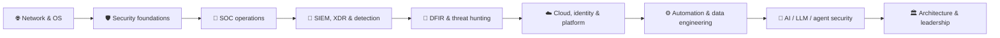

# 🛡️ SOC ANALYST ROADMAP
## 2026–27 · From first alert to security architecture

**Learn the signals · Investigate with evidence · Engineer the defense**

[🧭 Roadmap](#-complete-roadmap) · [🧪 Practice](#-labs--portfolio) · [🧰 Tools](#-trusted-references--tools) · [📂 Source materials](#-source-materials)

> [!IMPORTANT]
> **Authorized defensive learning only.** Use systems and data you own or have explicit permission to assess. Practice in isolated labs, use synthetic or public training data, and never publish credentials, secrets, or customer data.

---

## ✨ Your learning path

  

  

🔹 **Blue** · Foundations &nbsp;&nbsp; 🟩 **Green** · SOC practice &nbsp;&nbsp; 🟨 **Amber** · Labs & career &nbsp;&nbsp; 🟪 **Violet** · Advanced engineering

## 🧭 Complete roadmap

Explore the 38 learning topics from the `SOC-Analyst-Roadmap-main (2026-27)` materials. Each link opens its guide; this landing page is a navigation and learning overview.

### 🔹 Blue · Foundation & core skills

| # | Learning track | Focus |
|---|---|---|
| 01 | 🌐 [Network Fundamentals](SOC-Analyst-Roadmap-main%20(2026-27)/01-Network-Fundamentals.md) | Protocols, routing, network visibility, segmentation |
| 02 | 💻 [Operating System Fundamentals](SOC-Analyst-Roadmap-main%20(2026-27)/02-Operating-System-Fundamentals.md) | Windows, Linux, macOS, processes, services, logs |
| 03 | 🛡️ [Security Fundamentals](SOC-Analyst-Roadmap-main%20(2026-27)/03-Security-Fundamentals.md) | Security principles, access control, cryptography, risk |
| 04 | 🧭 [Cyber Kill Chain and MITRE](SOC-Analyst-Roadmap-main%20(2026-27)/04-Cyber-Kill-Chain-and-MITRE.md) | Adversary behavior, ATT&CK, defensive use cases |
| 05 | 🚩 [Threats, Attacks, and TTPs](SOC-Analyst-Roadmap-main%20(2026-27)/05-Threats-Attacks-and-TTPs.md) | Threat patterns across endpoints, identity, cloud, supply chains |
| 06 | 🪪 [Active Directory Fundamentals](SOC-Analyst-Roadmap-main%20(2026-27)/06-Active-Directory-Fundamentals.md) | Directory services, authentication, defensive visibility |
| 07 | ☁️ [Cloud Fundamentals](SOC-Analyst-Roadmap-main%20(2026-27)/07-Cloud-Fundamentals.md) | AWS, Azure, GCP, cloud identity and logging |
| 08 | 🤖 [AI Security Fundamentals](SOC-Analyst-Roadmap-main%20(2026-27)/08-AI-Security-Fundamentals.md) | AI/ML concepts, risks, responsible security |
| 09 | ⚙️ [Automation and Orchestration](SOC-Analyst-Roadmap-main%20(2026-27)/09-Automation-and-Orchestration.md) | Playbooks, SOAR concepts, human-approved automation |
| 10 | 🏗️ [SOC Architecture Guide](SOC-Analyst-Roadmap-main%20(2026-27)/10-SOC-Architecture-Guide.md) | SOC building blocks, operating models and architecture |

### 🟩 Green · SOC & engineering

| # | Learning track | Focus |
|---|---|---|
| 11 | 🚨 [Enterprise SOC Operations](SOC-Analyst-Roadmap-main%20(2026-27)/11-Enterprise-SOC-Operations.md) | Triage, escalation, service levels, metrics |
| 12 | 🎯 [Detection Engineering](SOC-Analyst-Roadmap-main%20(2026-27)/12-Detection-Engineering.md) | Detection logic, testing, tuning, quality |
| 13 | 🪟 [Microsoft Sentinel & Defender XDR](SOC-Analyst-Roadmap-main%20(2026-27)/13-Microsoft-Sentinel-Defender-XDR.md) | SIEM/XDR concepts and investigation workflows |
| 14 | 📊 [Splunk, SentinelOne, and Akamai](SOC-Analyst-Roadmap-main%20(2026-27)/14-Splunk-SentinelOne-Akamai.md) | SIEM, endpoint and web security telemetry |
| 15 | 🔐 [Identity & Cloud Security](SOC-Analyst-Roadmap-main%20(2026-27)/15-Identity-Cloud-Security.md) | Identity controls and cloud security operations |
| 16 | 🩹 [Vulnerability & Exposure Management](SOC-Analyst-Roadmap-main%20(2026-27)/16-Vulnerability-Exposure-Management.md) | Exposure context, prioritization, remediation |
| 17 | 🔬 [DFIR & Threat Hunting](SOC-Analyst-Roadmap-main%20(2026-27)/17-DFIR-Threat-Hunting.md) | Evidence handling, investigation, hunt methodology |
| 18 | 🔁 [SOAR & Security Automation](SOC-Analyst-Roadmap-main%20(2026-27)/18-SOAR-Security-Automation.md) | Safe, auditable response automation |
| 19 | 🧠 [AI, LLM, RAG, and Agent Security](SOC-Analyst-Roadmap-main%20(2026-27)/19-AI-LLM-RAG-Agent-Security.md) | AI application risks, retrieval and agent boundaries |
| 20 | 🏢 [Enterprise SOC Architecture](SOC-Analyst-Roadmap-main%20(2026-27)/20-Enterprise-SOC-Architecture.md) | Scalable SOC platforms, resilience, governance |
| 21 | 🧪 [SOC Labs & Projects](SOC-Analyst-Roadmap-main%20(2026-27)/21-SOC-Labs-Projects.md) | Structured defensive practice and portfolio projects |
| 22 | 🎓 [SOC Career & Certifications](SOC-Analyst-Roadmap-main%20(2026-27)/22-SOC-Career-Certifications.md) | Role progression, skills and certifications |

### 🟪 Violet · Advanced & architecture

| # | Learning track | Focus |
|---|---|---|
| 23 | 🧑‍💻 [Principal Security Engineering](SOC-Analyst-Roadmap-main%20(2026-27)/23-Principal-Security-Engineering.md) | Organization-wide security platforms and strategy |
| 24 | 🔒 [Zero Trust Architecture](SOC-Analyst-Roadmap-main%20(2026-27)/24-Zero-Trust-Architecture.md) | Identity-first access, policy and continuous evaluation |
| 25 | ☸️ [Cloud-Native Kubernetes Security](SOC-Analyst-Roadmap-main%20(2026-27)/25-Cloud-Native-Kubernetes-Security.md) | Workload, cluster and container security |
| 26 | 📦 [Software Supply Chain & AppSec](SOC-Analyst-Roadmap-main%20(2026-27)/26-Software-Supply-Chain-AppSec.md) | Secure development, dependencies, software provenance |
| 27 | 📡 [Platform Detection Engineering](SOC-Analyst-Roadmap-main%20(2026-27)/27-Platform-Detection-Engineering.md) | Detection platforms, data quality and scale |
| 28 | 🪪 [Advanced Identity Attack Paths](SOC-Analyst-Roadmap-main%20(2026-27)/28-Advanced-Identity-Attack-Paths.md) | Identity relationships, privilege paths, defensive analysis |
| 29 | 🧬 [Advanced DFIR & Malware](SOC-Analyst-Roadmap-main%20(2026-27)/29-Advanced-DFIR-Malware.md) | Forensic artifacts, timelines, safe analysis concepts |
| 30 | 🤖 [AI Agentic Security](SOC-Analyst-Roadmap-main%20(2026-27)/30-AI-Agentic-Security.md) | Agent permissions, prompt threats, trust boundaries |
| 31 | 🗃️ [Security Data Engineering](SOC-Analyst-Roadmap-main%20(2026-27)/31-Security-Data-Engineering.md) | Security data pipelines, schemas, observability |
| 32 | 🎯 [Exposure Management & CTEM](SOC-Analyst-Roadmap-main%20(2026-27)/32-Exposure-Management-CTEM.md) | Continuous exposure discovery and risk prioritization |
| 33 | ♻️ [Resilience & Ransomware Architecture](SOC-Analyst-Roadmap-main%20(2026-27)/33-Resilience-Ransomware-Architecture.md) | Recovery readiness, resilience and incident coordination |
| 34 | 🏭 [OT, IoT & Edge Security](SOC-Analyst-Roadmap-main%20(2026-27)/34-OT-IoT-Edge-Security.md) | Operational technology, connected devices and safety |
| 35 | 🔑 [Privacy, Cryptography & PQC](SOC-Analyst-Roadmap-main%20(2026-27)/35-Privacy-Cryptography-PQC.md) | Privacy engineering, key management, post-quantum readiness |
| 36 | ⚖️ [Architecture Governance & GRC](SOC-Analyst-Roadmap-main%20(2026-27)/36-Architecture-Governance-GRC.md) | Architecture reviews, risk and governance |
| 37 | 🧭 [Security Leadership 2027](SOC-Analyst-Roadmap-main%20(2026-27)/37-Security-Leadership-2027.md) | Technical strategy, communication, team leadership |
| 38 | 🛡️ [Vulnerability, Zero-Day & WAF Defense](SOC-Analyst-Roadmap-main%20(2026-27)/Vulnerability-Zero-Day-and-WAF/README.md) | Defensive vulnerability and web application protection |

---

## 🧪 Labs & portfolio

Build practical evidence as you learn. Use authorized labs and document assumptions and limitations.

| Project | Portfolio evidence |
|---|---|
| 📝 SOC investigation walkthrough | Incident timeline, evidence notes and lessons learned |
| 🎯 Detection-as-code starter pack | Scoped detections, test cases and tuning notes |
| 🔎 Threat-hunting report | Hypothesis, data sources, findings and lab queries |
| ☁️ Cloud logging review | Telemetry coverage diagram and visibility gaps |
| ⚙️ SOAR approval workflow | Safe simulation, human approval, audit trail and rollback |
| 🤖 AI application threat model | Trust boundaries, risk scenarios and mitigations for a toy application |
| 🏗️ Architecture decision record | Diagram, assumptions, trade-offs and follow-up actions |

## 🧰 Trusted references & tools

Official documentation and learning resources are a good starting point. Tool names are examples to explore—not endorsements or a requirement to use them all.

| Area | References |
|---|---|
| 🧭 Frameworks | [MITRE ATT&CK](https://attack.mitre.org/) · [NIST Cybersecurity Framework](https://www.nist.gov/cyberframework) · [CISA KEV Catalog](https://www.cisa.gov/known-exploited-vulnerabilities-catalog) |
| 🎯 Detection | [Sigma](https://sigmahq.io/) · [Microsoft Sentinel docs](https://learn.microsoft.com/azure/sentinel/) · [Splunk Security Content](https://research.splunk.com/) |
| 🌐 Network visibility | [Wireshark docs](https://www.wireshark.org/docs/) · [Zeek docs](https://docs.zeek.org/) |
| 🔬 Investigation | [Velociraptor docs](https://docs.velociraptor.app/) · [Security Onion docs](https://docs.securityonion.net/) |
| 🧪 Safe learning | [MITRE ATT&CK resources](https://attack.mitre.org/resources/) · [CISA resources](https://www.cisa.gov/resources-tools) · Vendor training tenants and isolated home labs |

## 📆 Suggested study rhythm

1. **Build foundations** — networking, operating systems and security basics.
2. **Learn the workflow** — SOC operations, alert triage, evidence and clear documentation.
3. **Practice detection** — SIEM concepts, ATT&CK mapping, testing and tuning.
4. **Broaden your view** — DFIR, hunting, identity, cloud and exposure management.
5. **Engineer responsibly** — automation, security data, AI security and platform design.
6. **Communicate impact** — architecture trade-offs, resilience, governance and portfolio outcomes.

## 📂 Source materials

- [📚 Main Documents index](SOC-Analyst-Roadmap-main%20(2026-27)/Main-Documents/README.md)
- [🗺️ Roadmap resources](SOC-Analyst-Roadmap-main%20(2026-27)/ROADMAP/)
- [🖼️ Diagrams](SOC-Analyst-Roadmap-main%20(2026-27)/DIAGRAMS/)
- [✅ Safe integration instructions](SOC-Analyst-Roadmap-main%20(2026-27)/INSTRUCTIONS.md)

**Built for curious defenders — from first alert to security architecture. 💙**

