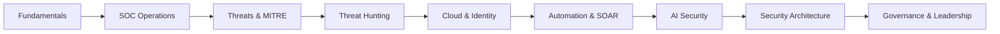

<div align="center">

# 🛡️ SOC Analyst Roadmap - 2026-27

### Learn the signals. Understand the threat. Design the defense.

A practical, end-to-end defensive cybersecurity learning path from SOC fundamentals to detection engineering, cloud security, identity protection, incident response, threat hunting, AI security, and security architecture.

[](01-Network-Fundamentals.md)
[](ROADMAP/SOC-OPERATIONS.md)
[](THREAT-HUNTING.md)
[](08-AI-Security-Fundamentals.md)

[Open the full portal](docs/index.md) · [Certification index](docs/certifications.md) · [SOC labs](docs/labs.md) · [Architecture docs](10-SOC-Architecture-Guide.md)

</div>

> [!IMPORTANT]
> This repository is intended for authorized defensive learning, lab exercises, and professional development. Do not run attacks or testing against systems you do not own or are not explicitly authorized to assess.

---

## Mission

This project exists to turn cybersecurity learning into a structured and practical journey—from networking and operating systems to SOC operations, threat hunting, cloud defense, AI security, automation, and enterprise architecture.

It is designed for:

- SOC analysts and incident responders
- Threat hunters and detection engineers
- Cloud and identity defenders
- Blue team practitioners
- Security engineers and architects
- Security professionals preparing for certifications and hands-on skill building

---

## Why this roadmap matters

Modern security teams need people who can do more than recognize alerts. They need defenders who can:

- understand the operating environment
- correlate telemetry across endpoint, identity, network, and cloud
- investigate incidents with evidence and context
- detect attacker tradecraft using MITRE ATT&CK
- design resilient defensive architecture
- apply AI and automation safely and responsibly

---
<p align="center">
  
  
  
  
</p>

> A practical, end-to-end defensive cybersecurity learning roadmap from SOC fundamentals to detection engineering, cloud security, incident response, and security architecture.

A modern cybersecurity learning platform built for defenders who want to transition from analyst work into detection engineering, security engineering, and enterprise security architecture.

## Why this project exists

The cyber workforce needs a stronger bridge between:

- hands-on SOC operations
- detection engineering and threat hunting
- cloud security and identity
- AI and automation in defense
- architecture, risk, and governance

This repository turns that journey into a structured, practical learning roadmap that combines fundamentals, labs, architecture thinking, and real-world blue team workflows.

## Learning journey



---

## Core knowledge library

| # | Document | Focus |
|---|---|---|
| 01 | [Network Fundamentals](01-Network-Fundamentals.md) | Protocols, routing, switching, firewalls, segmentation |
| 02 | [Operating System Fundamentals](02-Operating-System-Fundamentals.md) | Windows, Linux, macOS, services, logs, admin concepts |
| 03 | [Security Fundamentals](03-Security-Fundamentals.md) | CIA, defense-in-depth, IAM, PKI, risk, cryptography |
| 04 | [Cyber Kill Chain and MITRE](04-Cyber-Kill-Chain-and-MITRE.md) | Adversary lifecycle, ATT&CK, SOC use cases |
| 05 | [Threats, Attacks, and TTPs](05-Threats-Attacks-and-TTPs.md) | Malware, phishing, identity, cloud, supply chain, AI-related threats |
| 06 | [Active Directory Fundamentals](06-Active-Directory-Fundamentals.md) | Domain, trusts, Kerberos, NTLM, GPO, detection strategy |
| 07 | [Cloud Fundamentals](07-Cloud-Fundamentals.md) | AWS, Azure, GCP, IAM, logging, cloud attack surfaces |
| 08 | [AI Security Fundamentals](08-AI-Security-Fundamentals.md) | LLMs, ML, AI risks, model security, governance |
| 09 | [Automation and Orchestration](09-Automation-and-Orchestration.md) | SOAR, playbooks, orchestration, alert workflows |
| 10 | [SOC Architecture Guide](10-SOC-Architecture-Guide.md) | Traditional, modern, cloud, AI-powered SOC patterns |
| — | [Threat Hunting](THREAT-HUNTING.md) | Hunt methodologies, scenarios, platform mappings |
| — | [Threat Intelligence](THREAT-INTELLIGENCE.md) | Intel lifecycle, IOCs, feeds, SOC integration |

---
    H --> I[Governance, Leadership, Design]
```

## Mission

This repository has evolved from a learning roadmap into a full cyber defense knowledge base for:

- SOC analysts and incident responders
- Threat hunters and detection engineers
- Cloud and identity security engineers
- Blue team practitioners
- Security engineers and architects
- AI and automation-focused defenders

## Core knowledge library

| Module | Focus |
|---|---|
| [01-Network-Fundamentals.md](01-Network-Fundamentals.md) | Networking, protocols, devices, and security concepts |
| [02-Operating-System-Fundamentals.md](02-Operating-System-Fundamentals.md) | Windows, Linux, Unix, and macOS fundamentals |
| [03-Security-Fundamentals.md](03-Security-Fundamentals.md) | CIA, zero trust, IAM, cryptography, and controls |
| [04-Cyber-Kill-Chain-and-MITRE.md](04-Cyber-Kill-Chain-and-MITRE.md) | Tactics, techniques, frameworks, and use cases |
| [05-Threats-Attacks-and-TTPs.md](05-Threats-Attacks-and-TTPs.md) | Malware, phishing, identity, cloud, and AI threats |
| [06-Active-Directory-Fundamentals.md](06-Active-Directory-Fundamentals.md) | AD architecture, trust, Kerberos, NTLM, and detections |
| [07-Cloud-Fundamentals.md](07-Cloud-Fundamentals.md) | AWS, Azure, GCP, IAM, logging, and cloud attacks |
| [08-AI-Security-Fundamentals.md](08-AI-Security-Fundamentals.md) | AI, ML, LLM risk, and governance |
| [09-Automation-and-Orchestration.md](09-Automation-and-Orchestration.md) | SOAR, orchestration, and automation |
| [10-SOC-Architecture-Guide.md](10-SOC-Architecture-Guide.md) | SOC design, architecture patterns, and maturity |

## Career progression path

### Beginner to SOC Analyst
- Networking fundamentals
- Windows and Linux basics
- Security fundamentals and identity
- Attack chains, logs, and fundamentals of investigation

### SOC Analyst to Detection Engineer
- SIEM and telemetry design
- Detection logic and log normalization
- Threat hunting and hypothesis testing
- Tuning and feedback loops

### Detection Engineer to Security Architect
- Zero trust and defense-in-depth
- Cloud and identity security architecture
- Security governance and resilience design
- AI, automation, and modern SOC transformation

---

## Recommended learning order

1. Start with networking and operating system fundamentals.
2. Learn security foundations, identity, and access control.
3. Study attack methods using the cyber kill chain and MITRE ATT&CK.
4. Learn SOC triage, telemetry, and investigation skills.
5. Advance to threat hunting, detection engineering, and intelligence.
6. Add cloud security, automation, AI security, and enterprise architecture.

---

## Blue team principles

- Evidence before conclusions
- Least privilege and controlled access
- Defensive telemetry over noisy alerting
- Human investigation and validation of automation
- Continuous tuning based on observations
- Design for resilience, not just detection

---

## Practical exercises and labs
- Log sources and SIEM architecture
- Detection logic and tuning
- Threat hunting and IOC analysis
- Home-lab validation and practical testing

### Detection Engineer to Security Architect
- Security control design
- Cloud and zero-trust architecture
- Risk, governance, and resilience
- AI-enabled SOC and strategic operations design

## Recommended learning order

1. Start with networking and operating systems
2. Learn core security, identity, and access control
3. Review attack chains and adversary tradecraft
4. Master threat hunting and detections
5. Add cloud, automation, and AI security
6. Design and defend modern SOC architectures

## Blue team principles

- Evidence before conclusions
- Least privilege and scope control
- Defend with telemetry and detections
- Validate hypotheses with logs and forensic artifacts
- Automate repetitive triage carefully
- Design resilience, not just alerts

## Quick architecture view

This repository includes supporting sections for:

- hands-on SOC labs
- detection engineering concepts
- threat hunting scenarios
- architecture blueprints
- certification guidance
- attack simulation and investigation workflows

Explore the portal:

- [Landing page](docs/index.md)
- [Certification index](docs/certifications.md)
- [SOC lab index](docs/labs.md)

---

## Repository structure

```text
.
├── 01-Network-Fundamentals.md
├── 02-Operating-System-Fundamentals.md
├── 03-Security-Fundamentals.md
├── 04-Cyber-Kill-Chain-and-MITRE.md
├── 05-Threats-Attacks-and-TTPs.md
├── 06-Active-Directory-Fundamentals.md
├── 07-Cloud-Fundamentals.md
├── 08-AI-Security-Fundamentals.md
├── 09-Automation-and-Orchestration.md
├── 10-SOC-Architecture-Guide.md
├── DIAGRAMS/
├── ROADMAP/
├── SOC/
├── SOC-ARCHITECTURE/
├── THREAT-HUNTING.md
├── THREAT-INTELLIGENCE.md
├── docs/
├── LICENSE
├── README.md
└── .github/
```

## Repository usage

- Study one module at a time
- Practice with a home lab or sandbox
- Map findings to MITRE ATT&CK
- Capture detection ideas and investigation steps
- Build a portfolio with case notes and architecture diagrams
- Progress from operations to design and leadership

## Repository structure

```text
.
├── 01-Network-Fundamentals.md
├── 02-Operating-System-Fundamentals.md
├── 03-Security-Fundamentals.md
├── 04-Cyber-Kill-Chain-and-MITRE.md
├── 05-Threats-Attacks-and-TTPs.md
├── 06-Active-Directory-Fundamentals.md
├── 07-Cloud-Fundamentals.md
├── 08-AI-Security-Fundamentals.md
├── 09-Automation-and-Orchestration.md
├── 10-SOC-Architecture-Guide.md
├── DIAGRAMS/
├── ROADMAP/
├── SOC/
├── SOC-ARCHITECTURE/
├── LICENSE
├── README.md
└── .github/
```

## Project outcomes

By the end of the journey, you should be able to:

- investigate alerts and incidents with confidence
- build detection logic based on logs and adversary behavior
- understand identity, cloud, and endpoint security tradecraft
- design secure operational models for modern environments
- communicate technical risk in business and architecture terms

## Security and usage notice

- official vendor documentation
- platform labs and sandboxes
- home labs with safe isolation
- hands-on case reviews
- certification prep and portfolio projects

## License

This project is licensed under the MIT License. See the [LICENSE](LICENSE) file for details.

---

## License

This project is licensed under the MIT License. See [LICENSE](LICENSE) for details.

<div align="center">

Built for curious defenders — from fundamentals to resilient security architecture.

</div>
