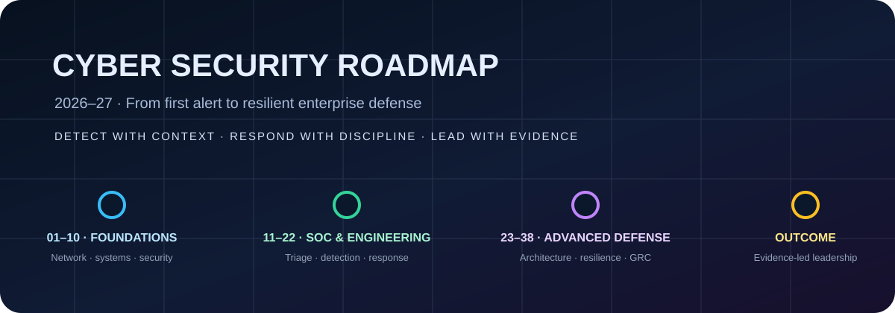

# 🛡️ Cyber Security Roadmap
### 2026–27 · Learn to detect, investigate, engineer, and govern security

**DETECT WITH CONTEXT · RESPOND WITH DISCIPLINE · LEAD WITH EVIDENCE**

[Start here](#-learning-roadmap) · [GRC](#-governance-risk--compliance) · [Vulnerability management](#-vulnerability--exposure-management) · [Tools](#-defensive-tool-guides) · [Safe use](#-responsible-use)

> [!IMPORTANT]
> **For authorized, defensive learning only.** Assess or monitor only systems and data you own or have explicit permission to use. Practice in isolated labs with synthetic or approved training data. Follow organizational policy, applicable law, and responsible disclosure requirements.

---

## 👋 About this roadmap

A practical, project-oriented learning path for people building skills in security operations, detection engineering, incident response, security engineering, architecture, and leadership. It brings technical learning together with **vulnerability management, governance, risk, privacy, and resilience**—so that security work is evidence-based and connected to accountable decisions.

Use the roadmap flexibly: choose a track for your current role, document hands-on learning, and revisit topics as your responsibilities grow. It is an educational resource, not a certification, compliance guarantee, or substitute for professional advice.

## 🧭 Learning roadmap

| Stage | Focus | Suggested evidence |
|---|---|---|
| 🔹 **01–10 · Foundations** | Networking, operating systems, security principles, cloud, identity, AI, automation, and SOC architecture | Notes, diagrams, isolated lab write-ups |
| 🟩 **11–22 · SOC & engineering** | SOC operations, SIEM/XDR, detection, DFIR, exposure management, automation, and career development | Triage reports, tested detections, project portfolio |
| 🟪 **23–38 · Advanced defense** | Security architecture, cloud-native security, supply chain, AI, resilience, GRC, leadership, and web defense | Threat models, architecture decisions, exercise findings |

### Browse the learning tracks

The complete set of 38 topic guides is in [`Main Document`](SOC-Analyst-Roadmap-main%20(2026-27)/Main%20Document/).

| Track | What you’ll explore |
|---|---|
| [01 · Network Fundamentals](SOC-Analyst-Roadmap-main%20(2026-27)/Main%20Document/01-Network-Fundamentals.md) | Protocols, routing, visibility, and segmentation |
| [02 · Operating System Fundamentals](SOC-Analyst-Roadmap-main%20(2026-27)/Main%20Document/02-Operating-System-Fundamentals.md) | Windows, Linux, macOS, processes, and logs |
| [03 · Security Fundamentals](SOC-Analyst-Roadmap-main%20(2026-27)/Main%20Document/03-Security-Fundamentals.md) | Security principles, access control, cryptography, and risk |
| [04 · Cyber Kill Chain and MITRE](SOC-Analyst-Roadmap-main%20(2026-27)/Main%20Document/04-Cyber-Kill-Chain-and-MITRE.md) | Adversary behavior and defensive mapping |
| [07 · Cloud Fundamentals](SOC-Analyst-Roadmap-main%20(2026-27)/Main%20Document/07-Cloud-Fundamentals.md) | Cloud identity, services, and logging |
| [10 · SOC Architecture Guide](SOC-Analyst-Roadmap-main%20(2026-27)/Main%20Document/10-SOC-Architecture-Guide.md) | SOC building blocks and operating models |
| [11 · Enterprise SOC Operations](SOC-Analyst-Roadmap-main%20(2026-27)/Main%20Document/11-Enterprise-SOC-Operations.md) | Triage, escalation, service levels, and metrics |
| [12 · Detection Engineering](SOC-Analyst-Roadmap-main%20(2026-27)/Main%20Document/12-Detection-Engineering.md) | Detection logic, testing, tuning, and quality |
| [16 · Vulnerability & Exposure Management](SOC-Analyst-Roadmap-main%20(2026-27)/Main%20Document/16-Vulnerability-Exposure-Management.md) | Contextual prioritization, remediation, and validation |
| [17 · DFIR & Threat Hunting](SOC-Analyst-Roadmap-main%20(2026-27)/Main%20Document/17-DFIR-Threat-Hunting.md) | Evidence handling, investigation, and hunt methodology |
| [19 · AI, LLM, RAG, and Agent Security](SOC-Analyst-Roadmap-main%20(2026-27)/Main%20Document/19-AI-LLM-RAG-Agent-Security.md) | AI application risks, retrieval, and agent boundaries |
| [24 · Zero Trust Architecture](SOC-Analyst-Roadmap-main%20(2026-27)/Main%20Document/24-Zero-Trust-Architecture.md) | Identity-first access and continuous evaluation |
| [26 · Software Supply Chain & AppSec](SOC-Analyst-Roadmap-main%20(2026-27)/Main%20Document/26-Software-Supply-Chain-AppSec.md) | Secure development, dependencies, and provenance |
| [32 · Exposure Management & CTEM](SOC-Analyst-Roadmap-main%20(2026-27)/Main%20Document/32-Exposure-Management-CTEM.md) | Continuous exposure discovery and risk prioritization |
| [36 · Architecture Governance & GRC](SOC-Analyst-Roadmap-main%20(2026-27)/Main%20Document/36-Architecture-Governance-GRC.md) | Architecture reviews, risk, and governance |
| [37 · Security Leadership 2027](SOC-Analyst-Roadmap-main%20(2026-27)/Main%20Document/37-Security-Leadership-2027.md) | Technical strategy, communication, and leadership |
| [38 · Vulnerability, Zero-Day & WAF Defense](SOC-Analyst-Roadmap-main%20(2026-27)/Vulnerability-Zero-Day-and-WAF/Vulnerability.md) | Defensive vulnerability and web application protection |

> Browse the linked folder for the remaining topics, plus [roadmap resources](SOC-Analyst-Roadmap-main%20(2026-27)/ROADMAP/) and [diagrams](SOC-Analyst-Roadmap-main%20(2026-27)/DIAGRAMS/).

## 🩹 Vulnerability & exposure management

Treat vulnerability work as a **risk-reduction lifecycle**, not a raw scanner-score race. Combine technical findings with asset criticality, exposure, exploit intelligence, business impact, and compensating controls. Confirm that remediation worked and record any remaining risk.

1. **Know the assets:** identify owners, business purpose, criticality, and internet or network exposure.
2. **Find and validate:** use authorized scanning and trusted advisories; verify affected products and reduce duplicate or stale findings.
3. **Prioritize with context:** consider severity, known exploitation, reachable attack paths, asset importance, data sensitivity, and available mitigations.
4. **Assign and treat:** give each action an accountable owner and due date; patch, upgrade, configure, isolate, or document an approved exception with compensating controls.
5. **Verify and learn:** rescan or otherwise validate the fix, retain evidence, track residual risk, and use recurring themes to improve secure design.

| Useful signal | Why it matters |
|---|---|
| Asset criticality and ownership | Makes remediation accountable and helps assess operational impact |
| Exploitability and exposure | Helps distinguish theoretical severity from actionable, reachable risk |
| Remediation age and service impact | Reveals overdue work and supports realistic change planning |
| Validation and exception status | Shows whether risk was actually reduced or formally accepted |

Related guides: [Vulnerability & Exposure Management](SOC-Analyst-Roadmap-main%20(2026-27)/Main%20Document/16-Vulnerability-Exposure-Management.md) · [Exposure Management & CTEM](SOC-Analyst-Roadmap-main%20(2026-27)/Main%20Document/32-Exposure-Management-CTEM.md) · [Vulnerability, Zero-Day & WAF Defense](SOC-Analyst-Roadmap-main%20(2026-27)/Vulnerability-Zero-Day-and-WAF/Vulnerability.md)

## 🏛️ Governance, Risk & Compliance

GRC connects technical controls to business objectives, legal and contractual obligations, risk ownership, and evidence. The [`Governance-Security/`](Governance-Security/) directory includes ten focused guides covering:

- **Governance and policy:** foundations, policy lifecycle, standards, exceptions, roles, and decision rights.
- **Risk and assurance:** assessment and treatment, control ownership, testing, audit evidence, and continuous improvement.
- **Privacy and obligations:** applicability, data governance, incident routing, and regulatory change.
- **Third parties:** supplier assurance, software dependencies, contractual expectations, and ongoing monitoring.

Start with [GRC Foundations](Governance-Security/01-GRC-FOUNDATIONS-AND-DEFINITIONS.md), then explore [risk assessment and treatment](Governance-Security/06-CYBER-RISK-ASSESSMENT-AND-TREATMENT.md), [compliance assurance and audit](Governance-Security/07-COMPLIANCE-ASSURANCE-AND-AUDIT.md), and [third-party and supply-chain risk](Governance-Security/09-THIRD-PARTY-AND-SUPPLY-CHAIN-RISK.md).

**Practical governance questions:** Who owns the risk? Which control outcome is required? What evidence demonstrates operation? Who can approve an exception or accept residual risk? When will the decision be reviewed?

> GRC materials are educational references, not legal advice or proof of compliance. Applicability depends on jurisdiction, industry, contracts, and organizational context. Confirm current requirements with qualified legal, privacy, compliance, and audit professionals.

## 🧰 Defensive tool guides

These guides introduce tools and workflows for authorized defensive work:

- [Threat Intelligence Tools](THREAT-INTELLIGENCE-TOOLS.md) — MISP, OpenCTI, VirusTotal, OTX, CISA KEV, STIX/TAXII
- [Threat Hunting Tools](THREAT-HUNTING-TOOLS.md) — Sentinel, Splunk, Elastic, Zeek, osquery, Velociraptor
- [DFIR & Forensics Tools](DFIR-FORENSICS-TOOLS.md) — evidence handling and forensic workflows
- [SIEM & SOAR Tools](SIEM-SOAR-TOOLS.md) — monitoring, investigation, and governed automation
- [AI SOC Tools](AI-SOC-TOOLS.md) — evaluation and safe adoption of AI-assisted workflows

## 📈 Measure outcomes, not activity alone

Adapt metrics to organizational risk, staffing, business hours, telemetry, and obligations. Set a baseline and define each measure before comparing trends; these are example measures, not live repository statistics or universal targets.

| Capability | Example measure | Review question |
|---|---|---|
| Visibility | Critical assets with usable, required telemetry | Which important services or identities are not visible? |
| Detection | Tested detections, actionable alert rate, and coverage gaps | Are detections reliable, explainable, and risk-relevant? |
| Response | Acknowledge, investigate, contain, and recovery times by severity | Where do handoffs or approvals delay safe action? |
| Exposure reduction | Risk-prioritized remediation age and validation status | Is material exposure reduced within agreed timeframes? |
| Resilience | Recovery exercise results and corrective actions | Can critical services recover, and are findings resolved? |
| Governance | Control evidence, exceptions, and overdue risk decisions | Are obligations traceable to accountable owners and evidence? |

## 📂 Repository resources

- [Main learning guides](SOC-Analyst-Roadmap-main%20(2026-27)/Main%20Document/)
- [Roadmap resources](SOC-Analyst-Roadmap-main%20(2026-27)/ROADMAP/)
- [Diagrams](SOC-Analyst-Roadmap-main%20(2026-27)/DIAGRAMS/)
- [Safe integration instructions](SOC-Analyst-Roadmap-main%20(2026-27)/INSTRUCTIONS.md)
- [Governance and security guides](Governance-Security/)
- [Vulnerability and web defense guide](SOC-Analyst-Roadmap-main%20(2026-27)/Vulnerability-Zero-Day-and-WAF/Vulnerability.md)

## 🤝 Learning and contributions

Use the guides as a starting point: keep notes, build small authorized lab projects, explain assumptions and limitations, and record what you learned. Contributions that improve clarity, accessibility, accuracy, defensive safety, or navigation are welcome. Avoid including real secrets, personal data, unapproved target information, or instructions for unauthorized activity.

## 🛡️ Responsible use

This repository is for education and defensive security. It does not authorize testing any system. Get explicit written permission and agree on scope before security testing; follow applicable laws, rules of engagement, and responsible disclosure processes. Do not use the material to access, disrupt, or expose systems or data without authorization.

**Evidence before conclusions · Least privilege · Resilience by design**

*Built for curious defenders and accountable security leaders.*

