# 🛡️ SOC Analyst Roadmap · 2026–27

### Learn the signals · Investigate with evidence · Build better defenses

A colorful, structured learning path from networking and SOC fundamentals to detection engineering, cloud defense, AI security, and security architecture.

[📚 Browse all topics](#-complete-roadmap) · [🧪 Labs & projects](#-practice-and-portfolio) · [🔗 References](#-trusted-references-and-tools)

> [!IMPORTANT]
> This roadmap is for **authorized defensive learning** and professional development. Use only systems, data, and labs you own or have explicit permission to assess. Verify tools and examples in an isolated environment; do not upload secrets or real customer data.

---

## 🌟 The learning journey

```mermaid
flowchart LR
    A[🌐 Networking & OS] --> B[🛡️ Security fundamentals]
    B --> C[🚨 SOC operations & triage]
    C --> D[🔎 SIEM, XDR & detection]
    D --> E[🧭 DFIR & threat hunting]
    E --> F[☁️ Cloud, identity & platform security]
    F --> G[⚙️ SOAR & security data engineering]
    G --> H[🤖 AI / LLM / agent security]
    H --> I[🏛️ Architecture, governance & leadership]
```

  

  

> **Color key:** <b>Blue</b> = foundations · <b>Green</b> = SOC practice · <b>Amber</b> = labs and career · <b>Purple</b> = advanced engineering and architecture. Badges and section labels provide the same cues where inline colors are not rendered.

---

## 🧭 Complete roadmap

All topics below are from the **SOC-Analyst-Roadmap-main (2026-27)** materials. Open a topic to read its full guide. The roadmap folder is linked for study; this README update does not modify its contents.

### 🔵 Foundation · Core skills

| # | Topic | What you’ll explore |
|---|---|---|
| 01 | [Network Fundamentals](SOC-Analyst-Roadmap-main%20(2026-27)/01-Network-Fundamentals.md) | Protocols, routing, network visibility, and segmentation |
| 02 | [Operating System Fundamentals](SOC-Analyst-Roadmap-main%20(2026-27)/02-Operating-System-Fundamentals.md) | Windows, Linux, macOS, processes, services, and logs |
| 03 | [Security Fundamentals](SOC-Analyst-Roadmap-main%20(2026-27)/03-Security-Fundamentals.md) | Security principles, access control, cryptography, and risk |
| 04 | [Cyber Kill Chain and MITRE](SOC-Analyst-Roadmap-main%20(2026-27)/04-Cyber-Kill-Chain-and-MITRE.md) | Adversary behavior, ATT&CK, and defensive use cases |
| 05 | [Threats, Attacks, and TTPs](SOC-Analyst-Roadmap-main%20(2026-27)/05-Threats-Attacks-and-TTPs.md) | Threat patterns across endpoints, identity, cloud, and supply chains |
| 06 | [Active Directory Fundamentals](SOC-Analyst-Roadmap-main%20(2026-27)/06-Active-Directory-Fundamentals.md) | Directory services, authentication, and defensive visibility |
| 07 | [Cloud Fundamentals](SOC-Analyst-Roadmap-main%20(2026-27)/07-Cloud-Fundamentals.md) | AWS, Azure, GCP, cloud identity, and logging |
| 08 | [AI Security Fundamentals](SOC-Analyst-Roadmap-main%20(2026-27)/08-AI-Security-Fundamentals.md) | AI/ML concepts, risks, and responsible security |
| 09 | [Automation and Orchestration](SOC-Analyst-Roadmap-main%20(2026-27)/09-Automation-and-Orchestration.md) | Playbooks, SOAR concepts, and human-approved automation |
| 10 | [SOC Architecture Guide](SOC-Analyst-Roadmap-main%20(2026-27)/10-SOC-Architecture-Guide.md) | SOC building blocks, operating models, and architecture |

### 🟢 SOC · Engineering tracks

| # | Topic | What you’ll explore |
|---|---|---|
| 11 | [Enterprise SOC Operations](SOC-Analyst-Roadmap-main%20(2026-27)/11-Enterprise-SOC-Operations.md) | Triage, escalation, service levels, and SOC metrics |
| 12 | [Detection Engineering](SOC-Analyst-Roadmap-main%20(2026-27)/12-Detection-Engineering.md) | Detection logic, testing, tuning, and quality |
| 13 | [Microsoft Sentinel & Defender XDR](SOC-Analyst-Roadmap-main%20(2026-27)/13-Microsoft-Sentinel-Defender-XDR.md) | SIEM/XDR concepts and investigation workflows |
| 14 | [Splunk, SentinelOne, and Akamai](SOC-Analyst-Roadmap-main%20(2026-27)/14-Splunk-SentinelOne-Akamai.md) | SIEM, endpoint, and web security telemetry |
| 15 | [Identity & Cloud Security](SOC-Analyst-Roadmap-main%20(2026-27)/15-Identity-Cloud-Security.md) | Identity controls and cloud security operations |
| 16 | [Vulnerability & Exposure Management](SOC-Analyst-Roadmap-main%20(2026-27)/16-Vulnerability-Exposure-Management.md) | Exposure context, prioritization, and remediation tracking |
| 17 | [DFIR & Threat Hunting](SOC-Analyst-Roadmap-main%20(2026-27)/17-DFIR-Threat-Hunting.md) | Evidence handling, investigation, and hunt methodology |
| 18 | [SOAR & Security Automation](SOC-Analyst-Roadmap-main%20(2026-27)/18-SOAR-Security-Automation.md) | Safe, auditable response automation |
| 19 | [AI, LLM, RAG, and Agent Security](SOC-Analyst-Roadmap-main%20(2026-27)/19-AI-LLM-RAG-Agent-Security.md) | AI application risks, retrieval, and agent boundaries |
| 20 | [Enterprise SOC Architecture](SOC-Analyst-Roadmap-main%20(2026-27)/20-Enterprise-SOC-Architecture.md) | Scalable SOC platforms, resilience, and governance |
| 21 | [SOC Labs & Projects](SOC-Analyst-Roadmap-main%20(2026-27)/21-SOC-Labs-Projects.md) | Structured defensive practice and portfolio projects |
| 22 | [SOC Career & Certifications](SOC-Analyst-Roadmap-main%20(2026-27)/22-SOC-Career-Certifications.md) | Role progression, skill development, and certifications |

### 🟣 Advanced · Architecture tracks

| # | Topic | What you’ll explore |
|---|---|---|
| 23 | [Principal Security Engineering](SOC-Analyst-Roadmap-main%20(2026-27)/23-Principal-Security-Engineering.md) | Organization-wide security platforms and engineering strategy |
| 24 | [Zero Trust Architecture](SOC-Analyst-Roadmap-main%20(2026-27)/24-Zero-Trust-Architecture.md) | Identity-first access, policy, and continuous evaluation |
| 25 | [Cloud-Native Kubernetes Security](SOC-Analyst-Roadmap-main%20(2026-27)/25-Cloud-Native-Kubernetes-Security.md) | Workload, cluster, and container security concepts |
| 26 | [Software Supply Chain & AppSec](SOC-Analyst-Roadmap-main%20(2026-27)/26-Software-Supply-Chain-AppSec.md) | Secure development, dependencies, and software provenance |
| 27 | [Platform Detection Engineering](SOC-Analyst-Roadmap-main%20(2026-27)/27-Platform-Detection-Engineering.md) | Detection platforms, data quality, and scale |
| 28 | [Advanced Identity Attack Paths](SOC-Analyst-Roadmap-main%20(2026-27)/28-Advanced-Identity-Attack-Paths.md) | Identity relationships, privilege paths, and defensive analysis |
| 29 | [Advanced DFIR & Malware](SOC-Analyst-Roadmap-main%20(2026-27)/29-Advanced-DFIR-Malware.md) | Forensic artifacts, timelines, and safe malware-analysis concepts |
| 30 | [AI Agentic Security](SOC-Analyst-Roadmap-main%20(2026-27)/30-AI-Agentic-Security.md) | Agent permissions, prompt threats, and trust boundaries |
| 31 | [Security Data Engineering](SOC-Analyst-Roadmap-main%20(2026-27)/31-Security-Data-Engineering.md) | Security data pipelines, schemas, and observability |
| 32 | [Exposure Management & CTEM](SOC-Analyst-Roadmap-main%20(2026-27)/32-Exposure-Management-CTEM.md) | Continuous exposure discovery and risk-informed prioritization |
| 33 | [Resilience & Ransomware Architecture](SOC-Analyst-Roadmap-main%20(2026-27)/33-Resilience-Ransomware-Architecture.md) | Recovery readiness, resilience, and incident coordination |
| 34 | [OT, IoT & Edge Security](SOC-Analyst-Roadmap-main%20(2026-27)/34-OT-IoT-Edge-Security.md) | Operational technology, connected devices, and safety context |
| 35 | [Privacy, Cryptography & PQC](SOC-Analyst-Roadmap-main%20(2026-27)/35-Privacy-Cryptography-PQC.md) | Privacy engineering, key management, and post-quantum readiness |
| 36 | [Architecture Governance & GRC](SOC-Analyst-Roadmap-main%20(2026-27)/36-Architecture-Governance-GRC.md) | Security architecture reviews, risk, and governance |
| 37 | [Security Leadership 2027](SOC-Analyst-Roadmap-main%20(2026-27)/37-Security-Leadership-2027.md) | Technical strategy, communication, and team leadership |
| 38 | [Vulnerability, Zero-Day & WAF Defense](SOC-Analyst-Roadmap-main%20(2026-27)/Vulnerability-Zero-Day-and-WAF/README.md) | Defensive vulnerability, exposure, and web application protection |

---

## 🧪 Practice and portfolio

Build practical evidence as you learn. Keep work in an authorized lab, use synthetic or public training data, and document assumptions and limitations.

| Project idea | Portfolio evidence |
|---|---|
| SOC investigation walkthrough | A concise incident timeline, evidence notes, and lessons learned |
| Detection-as-code starter pack | Clearly scoped rules, test cases, and tuning notes |
| Threat-hunting report | A hypothesis, data sources, findings, and reproducible queries for a lab |
| Cloud logging review | A diagram of telemetry coverage and documented visibility gaps |
| SOAR approval workflow | A safe simulation with human approval, audit trail, and rollback plan |
| AI application threat model | Trust boundaries, risk scenarios, and mitigations for a toy application |
| Security architecture decision | A diagram, assumptions, trade-offs, and follow-up actions |

## 🧰 Trusted references and tools

Start with official references and documentation; tools are examples to explore, not endorsements or a requirement to use them all.

| Area | References and examples |
|---|---|
| Frameworks & knowledge | [MITRE ATT&CK](https://attack.mitre.org/), [NIST Cybersecurity Framework](https://www.nist.gov/cyberframework), [CISA Known Exploited Vulnerabilities](https://www.cisa.gov/known-exploited-vulnerabilities-catalog) |
| Detection | [Sigma](https://sigmahq.io/), [Microsoft Sentinel documentation](https://learn.microsoft.com/azure/sentinel/), [Splunk Security content](https://research.splunk.com/) |
| Network visibility | [Wireshark](https://www.wireshark.org/docs/), [Zeek documentation](https://docs.zeek.org/) |
| Investigation & response | [Velociraptor documentation](https://docs.velociraptor.app/), [Security Onion documentation](https://docs.securityonion.net/) |
| Safe learning | [MITRE ATT&CK training](https://attack.mitre.org/resources/), [CISA resources](https://www.cisa.gov/resources-tools), vendor-provided training tenants and isolated home labs |

## 📅 Suggested study rhythm

1. **Build foundations:** networking, operating systems, and security basics.
2. **Learn the workflow:** SOC operations, alert triage, evidence, and clear documentation.
3. **Practice detection:** SIEM concepts, ATT&CK mapping, detection testing, and tuning.
4. **Broaden your view:** DFIR, hunting, identity, cloud, and exposure management.
5. **Engineer responsibly:** automation, security data, AI security, and platform design.
6. **Communicate impact:** architecture trade-offs, resilience, governance, and portfolio outcomes.

## 📁 Explore the source materials

- [Main Documents index](SOC-Analyst-Roadmap-main%20(2026-27)/Main-Documents/README.md)
- [Roadmap resources](SOC-Analyst-Roadmap-main%20(2026-27)/ROADMAP/)
- [Diagrams](SOC-Analyst-Roadmap-main%20(2026-27)/DIAGRAMS/)
- [Instructions and safe integration notes](SOC-Analyst-Roadmap-main%20(2026-27)/INSTRUCTIONS.md)

**Evidence before conclusions · Least privilege · Human-validated automation · Resilience by design**

Made for curious defenders — from first alert to security architecture. 💙

