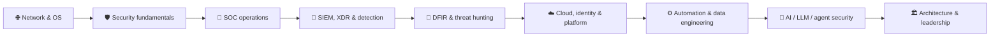

# 🛡️ SOC ANALYST ROADMAP
### 2026–27 · From first alert to security architecture

**LEARN THE SIGNALS　·　INVESTIGATE WITH EVIDENCE　·　ENGINEER THE DEFENSE**

[🧭 Roadmap](#-complete-roadmap) · [🎓 Certifications](#-certification-pathways) · [🔭 Future skills](#-future-security-drivers) · [🧰 Defensive tools](#-defensive-tool-guides)

> [!IMPORTANT]
> **Authorized defensive learning only.** Use systems and data you own or have explicit permission to monitor or assess. Practice in isolated labs, use synthetic or public training data, and never publish credentials, secrets, or customer data.

---

## 📊 SOC roadmap dashboard

| Learning stage | Mission | Evidence to build |
|---|---|---|
| 🔹 **01–10 · Foundation** | Network, operating systems, security, cloud and SOC architecture basics | Knowledge map, foundational labs, diagrams |
| 🟩 **11–22 · SOC operations** | Triage, SIEM/XDR, detection, DFIR, automation and career growth | Case reports, tested detections, portfolio |
| 🟪 **23–38 · Advanced defense** | Platform engineering, AI, resilience, governance and leadership | Threat models, architecture records, project demos |

`FOUNDATIONS → SOC ANALYST → DETECTION ENGINEER → SECURITY ENGINEER → SECURITY ARCHITECT / LEADER`

## 🧭 Complete roadmap

Explore the 38 learning topics from the `SOC-Analyst-Roadmap-main (2026-27)` materials. Each link opens its guide. Root-level tool guides are linked separately below; the roadmap folder remains unchanged.

### 🔹 Blue · Foundation & core skills

| # | Learning track | Focus |
|---|---|---|
| 01 | 🌐 [Network Fundamentals](SOC-Analyst-Roadmap-main%20(2026-27)/01-Network-Fundamentals.md) | Protocols, routing, network visibility, segmentation |
| 02 | 💻 [Operating System Fundamentals](SOC-Analyst-Roadmap-main%20(2026-27)/02-Operating-System-Fundamentals.md) | Windows, Linux, macOS, processes, services, logs |
| 03 | 🛡️ [Security Fundamentals](SOC-Analyst-Roadmap-main%20(2026-27)/03-Security-Fundamentals.md) | Security principles, access control, cryptography, risk |
| 04 | 🧭 [Cyber Kill Chain and MITRE](SOC-Analyst-Roadmap-main%20(2026-27)/04-Cyber-Kill-Chain-and-MITRE.md) | Adversary behavior, ATT&CK, defensive use cases |
| 05 | 🚩 [Threats, Attacks, and TTPs](SOC-Analyst-Roadmap-main%20(2026-27)/05-Threats-Attacks-and-TTPs.md) | Threat patterns across endpoints, identity, cloud, supply chains |
| 06 | 🪪 [Active Directory Fundamentals](SOC-Analyst-Roadmap-main%20(2026-27)/06-Active-Directory-Fundamentals.md) | Directory services, authentication, defensive visibility |
| 07 | ☁️ [Cloud Fundamentals](SOC-Analyst-Roadmap-main%20(2026-27)/07-Cloud-Fundamentals.md) | AWS, Azure, GCP, cloud identity and logging |
| 08 | 🤖 [AI Security Fundamentals](SOC-Analyst-Roadmap-main%20(2026-27)/08-AI-Security-Fundamentals.md) | AI/ML concepts, risks, responsible security |
| 09 | ⚙️ [Automation and Orchestration](SOC-Analyst-Roadmap-main%20(2026-27)/09-Automation-and-Orchestration.md) | Playbooks, SOAR concepts, human-approved automation |
| 10 | 🏗️ [SOC Architecture Guide](SOC-Analyst-Roadmap-main%20(2026-27)/10-SOC-Architecture-Guide.md) | SOC building blocks, operating models and architecture |

### 🟩 Green · SOC & engineering

| # | Learning track | Focus |
|---|---|---|
| 11 | 🚨 [Enterprise SOC Operations](SOC-Analyst-Roadmap-main%20(2026-27)/11-Enterprise-SOC-Operations.md) | Triage, escalation, service levels, metrics |
| 12 | 🎯 [Detection Engineering](SOC-Analyst-Roadmap-main%20(2026-27)/12-Detection-Engineering.md) | Detection logic, testing, tuning, quality |
| 13 | 🪟 [Microsoft Sentinel & Defender XDR](SOC-Analyst-Roadmap-main%20(2026-27)/13-Microsoft-Sentinel-Defender-XDR.md) | SIEM/XDR concepts and investigation workflows |
| 14 | 📊 [Splunk, SentinelOne, and Akamai](SOC-Analyst-Roadmap-main%20(2026-27)/14-Splunk-SentinelOne-Akamai.md) | SIEM, endpoint and web security telemetry |
| 15 | 🔐 [Identity & Cloud Security](SOC-Analyst-Roadmap-main%20(2026-27)/15-Identity-Cloud-Security.md) | Identity controls and cloud security operations |
| 16 | 🩹 [Vulnerability & Exposure Management](SOC-Analyst-Roadmap-main%20(2026-27)/16-Vulnerability-Exposure-Management.md) | Exposure context, prioritization, remediation |
| 17 | 🔬 [DFIR & Threat Hunting](SOC-Analyst-Roadmap-main%20(2026-27)/17-DFIR-Threat-Hunting.md) | Evidence handling, investigation, hunt methodology |
| 18 | 🔁 [SOAR & Security Automation](SOC-Analyst-Roadmap-main%20(2026-27)/18-SOAR-Security-Automation.md) | Safe, auditable response automation |
| 19 | 🧠 [AI, LLM, RAG, and Agent Security](SOC-Analyst-Roadmap-main%20(2026-27)/19-AI-LLM-RAG-Agent-Security.md) | AI application risks, retrieval and agent boundaries |
| 20 | 🏢 [Enterprise SOC Architecture](SOC-Analyst-Roadmap-main%20(2026-27)/20-Enterprise-SOC-Architecture.md) | Scalable SOC platforms, resilience, governance |
| 21 | 🧪 [SOC Labs & Projects](SOC-Analyst-Roadmap-main%20(2026-27)/21-SOC-Labs-Projects.md) | Structured defensive practice and portfolio projects |
| 22 | 🎓 [SOC Career & Certifications](SOC-Analyst-Roadmap-main%20(2026-27)/22-SOC-Career-Certifications.md) | Role progression, skills and certifications |

### 🟪 Violet · Advanced & architecture

| # | Learning track | Focus |
|---|---|---|
| 23 | 🧑‍💻 [Principal Security Engineering](SOC-Analyst-Roadmap-main%20(2026-27)/23-Principal-Security-Engineering.md) | Organization-wide security platforms and strategy |
| 24 | 🔒 [Zero Trust Architecture](SOC-Analyst-Roadmap-main%20(2026-27)/24-Zero-Trust-Architecture.md) | Identity-first access, policy and continuous evaluation |
| 25 | ☸️ [Cloud-Native Kubernetes Security](SOC-Analyst-Roadmap-main%20(2026-27)/25-Cloud-Native-Kubernetes-Security.md) | Workload, cluster and container security |
| 26 | 📦 [Software Supply Chain & AppSec](SOC-Analyst-Roadmap-main%20(2026-27)/26-Software-Supply-Chain-AppSec.md) | Secure development, dependencies, software provenance |
| 27 | 📡 [Platform Detection Engineering](SOC-Analyst-Roadmap-main%20(2026-27)/27-Platform-Detection-Engineering.md) | Detection platforms, data quality and scale |
| 28 | 🪪 [Advanced Identity Attack Paths](SOC-Analyst-Roadmap-main%20(2026-27)/28-Advanced-Identity-Attack-Paths.md) | Identity relationships, privilege paths, defensive analysis |
| 29 | 🧬 [Advanced DFIR & Malware](SOC-Analyst-Roadmap-main%20(2026-27)/29-Advanced-DFIR-Malware.md) | Forensic artifacts, timelines, safe analysis concepts |
| 30 | 🤖 [AI Agentic Security](SOC-Analyst-Roadmap-main%20(2026-27)/30-AI-Agentic-Security.md) | Agent permissions, prompt threats, trust boundaries |
| 31 | 🗃️ [Security Data Engineering](SOC-Analyst-Roadmap-main%20(2026-27)/31-Security-Data-Engineering.md) | Security data pipelines, schemas, observability |
| 32 | 🎯 [Exposure Management & CTEM](SOC-Analyst-Roadmap-main%20(2026-27)/32-Exposure-Management-CTEM.md) | Continuous exposure discovery and risk prioritization |
| 33 | ♻️ [Resilience & Ransomware Architecture](SOC-Analyst-Roadmap-main%20(2026-27)/33-Resilience-Ransomware-Architecture.md) | Recovery readiness, resilience and incident coordination |
| 34 | 🏭 [OT, IoT & Edge Security](SOC-Analyst-Roadmap-main%20(2026-27)/34-OT-IoT-Edge-Security.md) | Operational technology, connected devices and safety |
| 35 | 🔑 [Privacy, Cryptography & PQC](SOC-Analyst-Roadmap-main%20(2026-27)/35-Privacy-Cryptography-PQC.md) | Privacy engineering, key management, post-quantum readiness |
| 36 | ⚖️ [Architecture Governance & GRC](SOC-Analyst-Roadmap-main%20(2026-27)/36-Architecture-Governance-GRC.md) | Architecture reviews, risk and governance |
| 37 | 🧭 [Security Leadership 2027](SOC-Analyst-Roadmap-main%20(2026-27)/37-Security-Leadership-2027.md) | Technical strategy, communication, team leadership |
| 38 | 🛡️ [Vulnerability, Zero-Day & WAF Defense](SOC-Analyst-Roadmap-main%20(2026-27)/Vulnerability-Zero-Day-and-WAF/README.md) | Defensive vulnerability and web application protection |

## 🧰 Defensive tool guides · root-level references

These standalone guides live in the repository root—not inside the roadmap folder.

| Guide | Covers |
|---|---|
| 🧭 [Threat Intelligence Tools](THREAT-INTELLIGENCE-TOOLS.md) | MISP, OpenCTI, VirusTotal, OTX, CISA KEV, STIX/TAXII |
| 🔎 [Threat Hunting Tools](THREAT-HUNTING-TOOLS.md) | Sentinel, Splunk, Elastic, Zeek, osquery, Velociraptor, ATT&CK Navigator |
| 🔬 [DFIR & Forensics Tools](DFIR-FORENSICS-TOOLS.md) | Autopsy, Volatility 3, Plaso, KAPE, Velociraptor, evidence handling |
| 📊 [SIEM & SOAR Tools](SIEM-SOAR-TOOLS.md) | Sentinel, Splunk, Elastic, Google SecOps, Wazuh, XSOAR, Tines, Shuffle |
| 🤖 [AI SOC Tools](AI-SOC-TOOLS.md) | Intezer and other AI-assisted SOC examples, evaluation and safe adoption |

## 🎓 Certification pathways

Select certifications according to your goals, experience, region, budget, and employer requirements. They complement hands-on capability; they do not replace practical evidence. Confirm current exams, eligibility, and renewal rules with each issuer.

| Direction | Examples to research | Pair with |
|---|---|---|
| 🌱 Starting out | [CompTIA Security+](https://www.comptia.org/certifications/security) · [ISC2 CC](https://www.isc2.org/certifications/cc) | Networking notes and foundational lab write-ups |
| 🚨 SOC / incident response | [CompTIA CySA+](https://www.comptia.org/certifications/cybersecurity-analyst) · [GIAC GCIH](https://www.giac.org/certifications/certified-incident-handler-gcih/) | Triage cases, timelines, incident reports |
| 🔎 Microsoft security operations | [Microsoft SC-200](https://learn.microsoft.com/credentials/certifications/security-operations-analyst/) | Sentinel / Defender investigation portfolio |
| 📊 Splunk operations | [Splunk certification paths](https://www.splunk.com/en_us/training/certification-track.html) | Search examples, dashboards, tuning notes |
| ☁️ Cloud security | [AWS Security Specialty](https://aws.amazon.com/certification/certified-security-specialty/) · [Microsoft credentials](https://learn.microsoft.com/credentials/browse/?products=azure) · [Google Cloud certifications](https://cloud.google.com/learn/certification) | Cloud logging and configuration review |
| 🏛️ Senior architecture / leadership | [CISSP](https://www.isc2.org/certifications/cissp) · [CISM](https://www.isaca.org/credentialing/cism) | Architecture decisions, risk communication, leadership examples |

## 🔭 Future security drivers

| Driver | Defensive learning focus |
|---|---|
| 🤖 AI and autonomous agents | Threat modeling, data boundaries, tool permissions, oversight and evaluation |
| ☁️ Cloud-native platforms | Workload identity, containers, Kubernetes controls and runtime visibility |
| 🪪 Identity-first security | Phishing-resistant authentication, privileged access, machine identities |
| 🔗 Software supply chain | Dependency governance, SBOMs, provenance and build integrity |
| 📈 Security data engineering | Data quality, telemetry coverage, privacy-aware analytics and detection testing |
| 🧩 Continuous exposure management | Asset context, exploitability, business impact and remediation validation |
| ♻️ Cyber resilience | Recovery readiness, crisis exercises and tested response procedures |
| 🏭 OT, IoT and edge | Safety, availability, asset visibility and segmentation |
| 🔐 Privacy and cryptographic change | Data minimization, key lifecycle, crypto agility and post-quantum readiness |
| 🌍 Governance and third-party risk | Evidence, supplier assurance, privacy obligations and risk ownership |

## 🗺️ Future learning plan

| Phase | Goal | Suggested deliverable |
|---|---|---|
| **1 · Establish** | Networking, operating systems, identity and security principles | Knowledge map and isolated lab plan |
| **2 · Operate** | Triage, evidence, escalation and communication | Synthetic-case investigation reports |
| **3 · Detect** | Query languages, ATT&CK mapping, detection tests and tuning | Small detection pack with limitations |
| **4 · Investigate** | DFIR, hunting, cloud and identity skills | Hunt report and visibility review |
| **5 · Engineer** | Automation, security data, platforms and AI security | Human-approved automation demo and AI threat model |
| **6 · Design** | Architecture, resilience, governance and leadership | Architecture diagram and decision record |
| **7 · Refresh** | Reassess skills as technology and standards evolve | Quarterly learning review and updated portfolio |

## 📂 Roadmap source materials

- [📚 Main Documents index](SOC-Analyst-Roadmap-main%20(2026-27)/Main-Documents/README.md)
- [🗺️ Roadmap resources](SOC-Analyst-Roadmap-main%20(2026-27)/ROADMAP/)
- [🖼️ Diagrams](SOC-Analyst-Roadmap-main%20(2026-27)/DIAGRAMS/)
- [✅ Safe integration instructions](SOC-Analyst-Roadmap-main%20(2026-27)/INSTRUCTIONS.md)

**Built for curious defenders — from first alert to security architecture. 💙**

