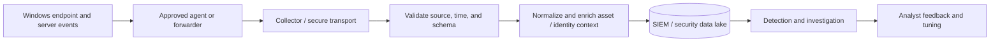
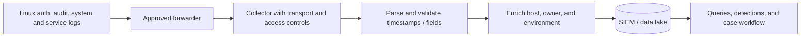
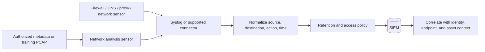
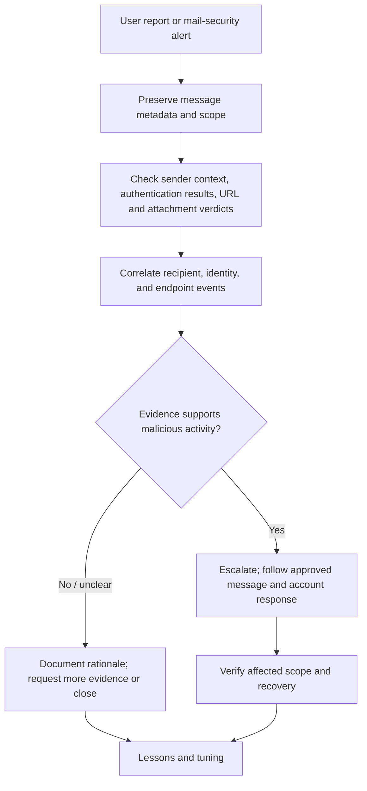
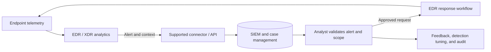
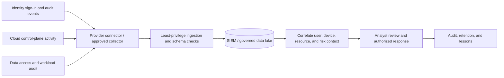
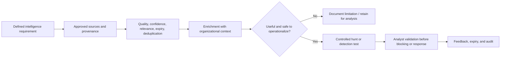
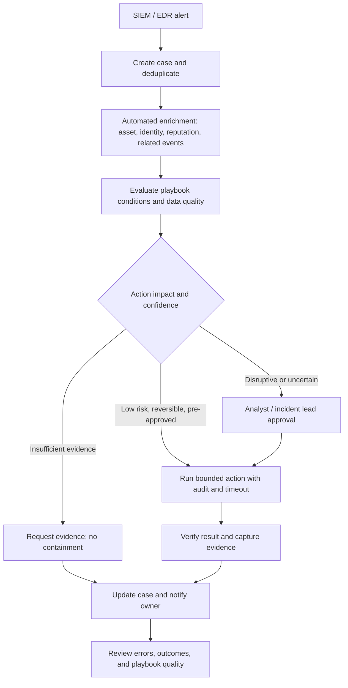
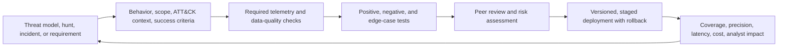

# Topic workflow diagrams

These conceptual, defensive diagrams show how common security topics connect to people, telemetry, tools, decisions, and feedback. Product names are examples; exact connectors and features depend on licensing and configuration. Use authorized labs and synthetic/public training data.

## Windows endpoint to SIEM

## Linux host to SIEM

## Firewall and network sensor to SIEM

## Email security investigation

## EDR / XDR to SIEM and case management

## Cloud and identity audit to SIEM

## Threat intelligence to detection workflow

## SOAR: alert to controlled action

## Detection-engineering feedback loop

## Diagram conventions

- Arrows represent logical data or decision flow, not a product-specific deployment guarantee.
- A human approval gate is explicit before disruptive actions such as disabling accounts or isolating business-critical systems.
- Add trust boundaries, data residency, ownership, retention, failure handling, and cost when adapting these diagrams to a real architecture.
- For the broader learning, triage, incident response, and cloud-native diagrams, see [FLOWCHARTS.md](FLOWCHARTS.md).
