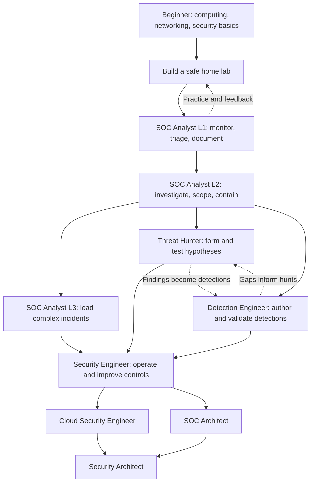
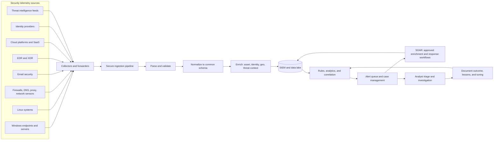
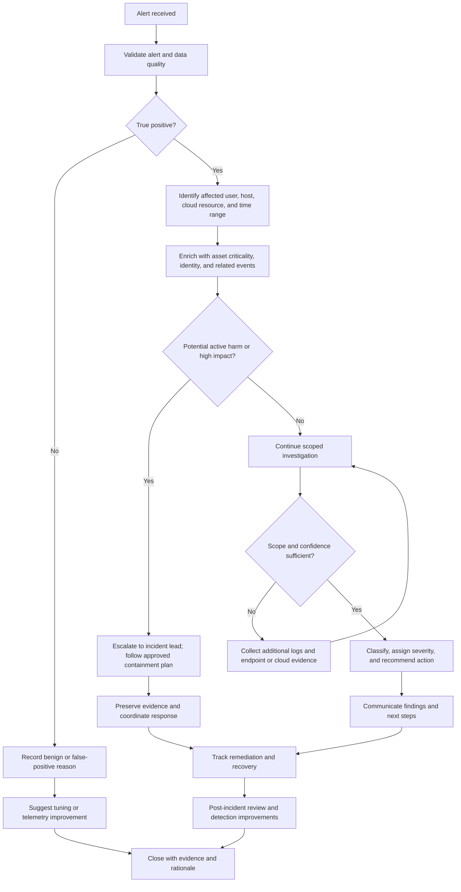
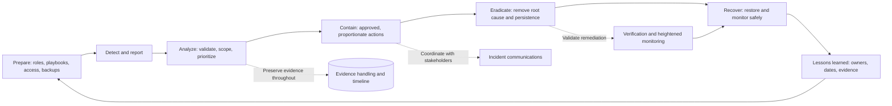
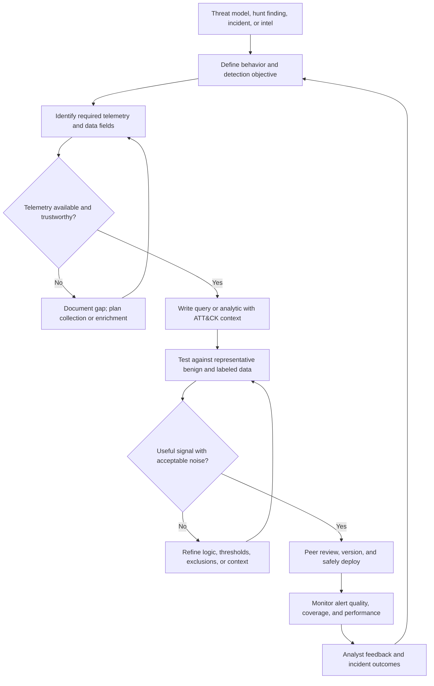
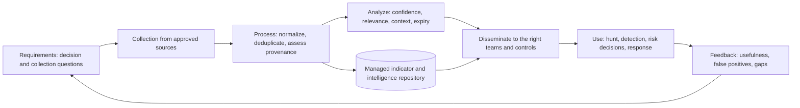
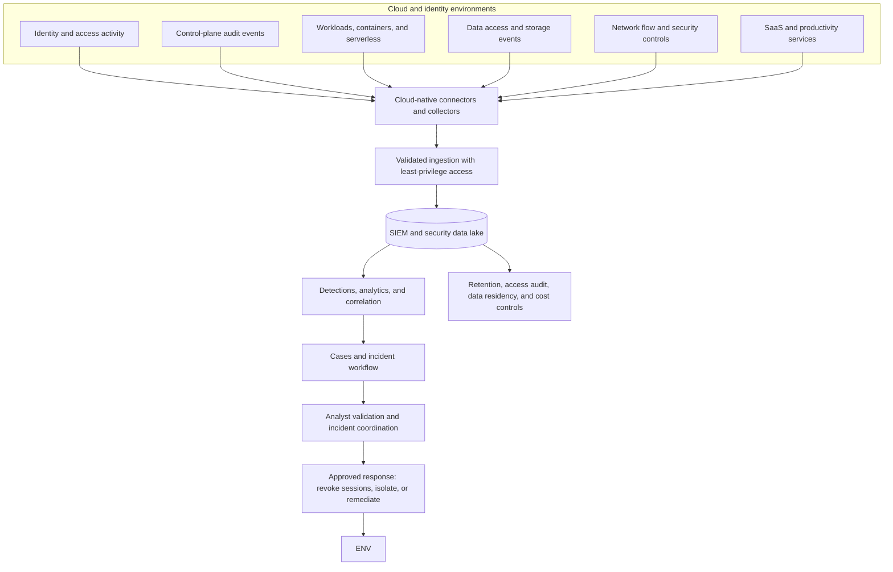
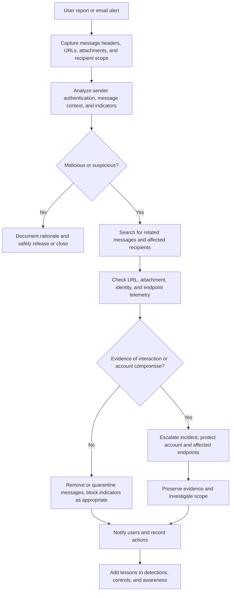

# SOC and Security Architecture Flowcharts

Reusable Mermaid flowcharts for the learning paths and defensive operations described in this repository. GitHub renders these diagrams directly in Markdown. They are conceptual reference diagrams; adapt components, retention, access controls, and escalation criteria to your environment.

## 1. Learning journey: beginner to security architect

## 2. SOC telemetry and log pipeline

## 3. Alert triage and escalation

## 4. Incident response lifecycle

## 5. Detection engineering feedback loop

## 6. Threat intelligence lifecycle

## 7. Cloud-native SOC reference flow

## 8. Phishing investigation workflow

## Rendering and contribution notes

- Keep diagrams focused on one workflow and use descriptive node labels.
- Prefer Mermaid `flowchart` syntax for GitHub Markdown compatibility.
- Distinguish automated actions from analyst decisions; require authorization for disruptive containment.
- Validate Mermaid changes in GitHub preview before merging.
