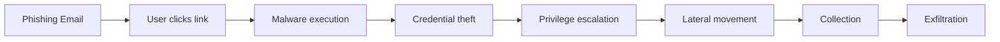

# 04. Cyber Kill Chain and MITRE ATT&CK

> Adversary tradecraft, attack phases, tactics, techniques, and SOC applications.

## Overview

The cyber kill chain and MITRE ATT&CK provide structured models for understanding how attacks are executed. They help defenders build detections, map incidents, and improve threat hunting and architecture decisions.

---

## Cyber Kill Chain

### 1. Reconnaissance
Attackers gather intel about targets, exposed services, or user identities.

### 2. Weaponization
Malicious payloads or social engineering content are prepared.

### 3. Delivery
Payloads are sent via email, web, removable media, or cloud vectors.

### 4. Exploitation
Attackers exploit a vulnerability or user action.

### 5. Installation
Malware or persistence mechanisms are placed on systems.

### 6. Command and Control
The compromised host connects back to attacker infrastructure.

### 7. Actions on Objectives
The adversary steals data, moves laterally, or causes disruption.

### SOC use
The kill chain helps analysts think in terms of phases, detection opportunities, and response timing.

---

## MITRE ATT&CK

MITRE ATT&CK is a matrix of adversary behavior organized by tactics and techniques.

### Tactics
- Initial Access
- Execution
- Persistence
- Privilege Escalation
- Defense Evasion
- Credential Access
- Discovery
- Lateral Movement
- Collection
- Exfiltration
- Impact

### Techniques
Techniques are the specific methods used to accomplish a tactic.

### Procedures
Procedures are real-world combinations of techniques used by attackers in actual incidents.

---

## Tactic Coverage

| Tactic | Example behavior |
|---|---|
| Initial Access | Phishing, exposed remote access |
| Execution | PowerShell, WMI, scheduled tasks |
| Persistence | Startup folders, services, malicious tasks |
| Privilege Escalation | Token manipulation, sudo abuse |
| Defense Evasion | Obfuscation, masquerading, disable Defender |
| Credential Access | Mimikatz, token theft, Kerberoasting |
| Discovery | Network enumeration, host discovery |
| Lateral Movement | RDP, PsExec, SMB, WMI |
| Collection | Data staging, clipboard capture |
| Exfiltration | DNS tunneling, HTTP upload |
| Impact | Ransomware, destruction, DoS |

---

## Platform Mapping

### Windows
- PowerShell execution
- WMI persistence
- PsExec lateral movement
- Registry abuse

### Linux
- cron modification
- SSH key abuse
- bash history use
- rootkit installation

### Cloud
- IAM privilege escalation
- Storage bucket abuse
- API token theft
- malicious workload deployment

### Identity
- Kerberoasting
- Password spraying
- MFA fatigue
- token replay

### M365
- OAuth abuse
- mailbox exfiltration
- phishing campaigns
- suspicious inbox forwarding

---

## SOC Use Cases

- Map alerts to ATT&CK techniques for case summary
- Prioritize hunts based on tactic coverage gaps
- Build detection logic around suspicious behavior chains
- Align response playbooks to adversary progression
- Correlate endpoint, identity, network, and cloud telemetry

---

## Sample Attack Flow

---

## Threat Hunting with MITRE

Examples:
- Hunt for unusual PowerShell command lines
- Look for scheduled task creation after startup
- Review suspicious Kerberos service ticket requests
- Check for remote admin tools under unusual user contexts
- Investigate unusual cloud IAM policy changes

---

## Interview Questions

- What is the difference between the kill chain and ATT&CK?
- Why is ATT&CK useful for detections?
- Which ATT&CK tactics are most relevant in identity attacks?
- How do you transform an alert into a mapped attack sequence?
- What is a procedure in ATT&CK terms?

---

## Conclusion

MITRE ATT&CK and the kill chain turn attacker behavior into a structured defense model. This helps SOC teams move from noisy alerts to meaningful hunts, detections, and response decisions.
