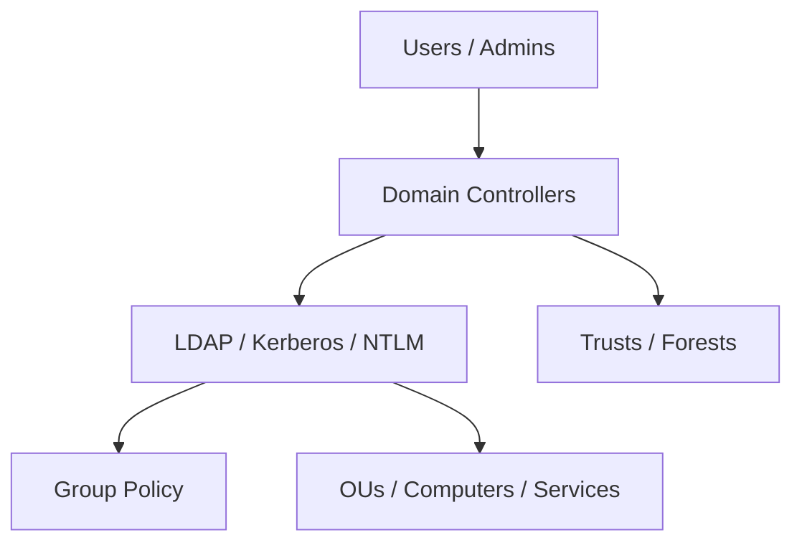

# 06. Active Directory Fundamentals

> Core identity architecture, trust relationships, Kerberos, NTLM, and AD security detections.

## Overview

Active Directory is the heart of many enterprise identity and access deployments. It stores user, computer, and service identity data and enforces authentication, authorization, and access policy across Windows networks.

---

## Core Concepts

### Domain
A logical security boundary with shared identity and policy.

### Forest
A collection of one or more domains sharing a common schema and configuration.

### Tree
A hierarchical set of domains with trust relationships.

### Trust
Enables access between domains and forests under defined rules.

### OU
Organizational Unit used to organize users, groups, and computers.

### GPO
Group Policy Object centralizes configuration and security settings.

### DNS integration
AD relies on DNS for service discovery and domain resolution.

### LDAP
Lightweight Directory Access Protocol used for querying and updating directory objects.

### Kerberos
Strong authentication protocol used for domain access.

### NTLM
Legacy authentication protocol still used in Windows environments.

### Domain controllers
Servers that authenticate users and manage directory services.

---

## AD Architecture

---

## AD Security Risks

### Golden Ticket
An attacker forges a Kerberos TGT to impersonate any user or domain admin.

### Silver Ticket
Forged Kerberos service ticket allowing access to a specific service.

### Kerberoasting
Targets service account hashes to crack service passwords offline.

### ASREPRoasting
Abuses Kerberos pre-authentication to crack user passwords.

### Pass the Hash
Reuses NTLM hashes without plaintext passwords.

### Pass the Ticket
Uses stolen Kerberos tickets for impersonation.

### DCSync
Simulates a domain controller to replicate directory data.

---

## Detection Strategies

- Monitor Kerberos ticket activity and unusual privilege tickets
- Detect DC replication or replication-like behavior
- Hunt for suspicious service account activity
- Review risky logon patterns and privileged group changes
- Alert on new admin users, membership changes, and GPO edits
- Correlate AD events with endpoint and M365 telemetry

### Key event IDs
- 4624 / 4625 logons
- 4672 special privilege assignment
- 4720 account creation
- 4728/4732 group membership changes
- 4768/4769 Kerberos tickets
- 4771 failed Kerberos pre-auth
- 5136 directory services modified

---

## SOC Hunting Scenarios

- Multiple failed Kerberos pre-auth attempts across accounts
- New privileged service accounts created in a short period
- Unusual DC-to-DC replication traffic
- Admin logon without expected reason or schedule
- Privileged group membership changes after business hours

---

## Operational Guidance

- Restrict who can read or write sensitive AD objects
- Limit domain admin membership and use tiered administration
- Enable strong logging and alerting on AD changes
- Monitor service accounts and SPNs
- Secure Kerberos and reduce NTLM exposure

---

## Interview Questions

- What is the purpose of a domain controller?
- How does Kerberos differ from NTLM?
- What makes DCSync dangerous?
- Why is Group Policy important in AD?
- How does AD trust affect access boundaries?

---

## Conclusion

AD is a high-value target because it governs identity, privilege, and trust across the enterprise. SOC teams must monitor for service abuse, stale accounts, unusual logons, and sophisticated Kerberos-based attacks.
