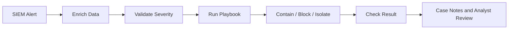

# 09. Automation and Orchestration

> Security automation, SOAR, playbooks, and operational efficiency across SOC workflows.

## Overview

Security operations are high-volume and repetitive. Automation and orchestration help reduce manual effort, improve consistency, and speed up containment and investigation while keeping human approval for high-risk actions.

---

## Security Automation

Security automation uses logic and tools to execute predefined tasks consistently.

Examples:
- Enrichment of suspicious IPs
- Ticket creation and case routing
- User lockout or mailbox isolation
- Containment actions

## Workflow Automation

Workflow automation connects systems across environments to streamline repeated tasks across many tools.

Examples:
- SIEM to ticketing
- EDR to SOAR
- Identity platform to incident response

---

## SOAR

SOAR platforms orchestrate detection, triage, response, and case management.

### Core features
- Playbooks
- Case management
- Enrichment integrations
- Incident workflow mapping
- Human approval gates

---

## Playbooks

Playbooks describe repeatable steps for handling alerts and incidents.

### Example playbook types
- Email security playbook
- Malware triage
- Ransomware response
- Identity attack escalation
- Endpoint incident investigation

---

## Automation Tools

- Microsoft Logic Apps
- Cortex XSOAR
- Splunk SOAR
- TheHive
- Shuffle

### Use cases
- Enrichment via VirusTotal, MISP, or threat intel platforms
- Ticketing with Jira or ServiceNow
- Blocking malicious IPs or accounts
- Isolating hosts via EDR

---

## 50 Automation Playbooks

### Email Security
- Suspicious phishing email triage
- Malicious attachment handling
- New sender domain reputation check
- Link click investigation
- Mailbox compromise workflow

### Malware
- Suspicious file hash check
- Endpoint isolation workflow
- Sandbox detonation triage
- Quarantine from endpoint
- Malware campaign correlation

### Ransomware
- Ransomware alert enrichment
- Host isolation
- Shared drive lockdown
- Backup validation
- Analyst escalation workflow

### Identity Attacks
- Password spray response
- MFA fatigue investigation
- Account lockout process
- Kerberoasting triage
- Impossible travel investigation

### Endpoint Incidents
- Process execution investigation
- Lateral movement confirmation
- Endpoint containment
- User session logout
- Persistence review workflow

---

## Key Automation Design Principles

- Keep actions reversible when possible
- Require human approval for destructive actions
- Validate inputs and enrichments before blocking
- Log every automated decision
- Use alert suppression carefully and with review

---

## Example SOAR Flow

---

## Implementation Considerations

- API reliability and rate limits
- Credential and secret handling
- Tool ownership and support model
- Versioned playbooks and change control
- Testing in safe environments

---

## Interview Questions

- What is the difference between automation and orchestration?
- Why is approval required for high-risk response actions?
- What does a good SOAR playbook include?
- Which SOC workflows are ideal for automation?
- How do you validate automation before deployment?

---

## Conclusion

SOAR and automation reduce analyst fatigue and improve response quality. The key is to automate the repetitive, low-risk tasks while preserving human judgment for high-impact security decisions.
