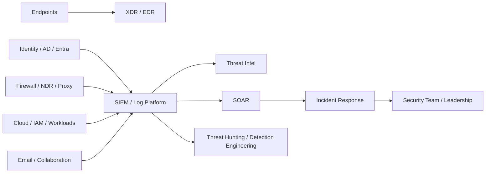

# 10. SOC Architecture Guide

> Modern SOC design principles, reference patterns, and architecture diagrams for enterprise security operations.

## Overview

A modern SOC is more than a team; it is a coordinated architecture of telemetry, detection, identity, automation, response workflows, and governance. This guide covers foundational and modern design patterns used in enterprise and cloud-native environments.

---

## 1. Traditional SOC Architecture

A classic model includes:
- SIEM
- Endpoint tools
- Firewall and network telemetry
- Ticketing systems
- Analysts and IR team

### Characteristics
- Centralized monitoring
- Mostly on-prem and vendor-rich
- Manual triage and escalation
- Slower onboarding of new data sources

---

## 2. Modern SOC Architecture

Includes:
- XDR and identity telemetry
- Cloud logs and SaaS monitoring
- Threat intelligence enrichment
- SOAR automation
- Detection engineering and hunting

### Benefits
- Better coverage across identities, endpoints, and cloud
- Faster investigation workflows
- Improved architectural flexibility

---

## 3. AI-Powered SOC Architecture

AI-enabled SOC architecture layers include:
- telemetry normalization
- correlation and enrichment
- AI-driven triage and summarization
- analyst review and escalation
- response automation with approval gates

---

## 4. MSSP SOC Architecture

Multi-client SOC design emphasizes:
- tenant isolation
- central platform with segmented views
- standardized playbooks
- client reporting and SLAs
- scalable case management

---

## 5. Cloud-Native SOC Architecture

- cloud-native telemetry from AWS/Azure/GCP
- centralized SIEM or log analytics
- workload security and container monitoring
- API-driven alerting and response

---

## 6. Multi-Cloud SOC Architecture

Use common control patterns across all environments:
- centralized identity and log collection
- common detection logic
- cross-cloud observability
- role-based access and policy controls

---

## 7. Enterprise SOC Architecture

A full enterprise SOC integrates:
- endpoints
- identity
- email security
- network visibility
- cloud security
- data lake and analytics
- incident response
- threat intelligence

---

## Core SOC Components

| Component | Purpose |
|---|---|
| Telemetry sources | Generate security and operational data |
| Log normalization | Standardize events before analysis |
| Detection engine | Analyze for malicious patterns |
| Threat intel | Enrich indicators and campaigns |
| SOAR | Automate routine response workflows |
| Case management | Manage investigations and actions |
| Identity controls | Secure admin access and privileged accounts |
| Reporting | Provide metrics and stakeholder updates |

---

## Example Modern SOC Design

---

## SOC Design Principles

- Collect the right telemetry, not just a lot of data
- Enforce least privilege and separation of duties
- Build flexible, layered detection pipelines
- Automate low-risk tasks with human approval for higher risk
- Design for scalability and resilience

---

## Detection Engineering and Threat Hunting

Architecture should support:
- tunable detections
- normalized data sources
- testable use cases
- threat hunting workflows
- metric-driven improvements

---

## Interview Questions

- What are the differences between a traditional and modern SOC?
- Why is telemetry normalization important?
- How does SOAR improve SOC efficiency?
- What is the role of threat intelligence in architecture design?
- Why do cloud-native SOCs require different control patterns?

---

## Conclusion

A strong SOC architecture aligns people, processes, platform telemetry, workflow automation, and governance. The best designs balance operational speed with alert quality, data trust, and scalable defense.
