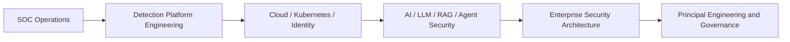

# 🛡️ Enterprise Security Operations & AI Security Roadmap
### Ultimate SOC Analyst Roadmap — Advanced 2027 Expansion

**SOC L1 → L2 → L3 → Detection Engineer → Security Architect → Principal Security Engineer**

  

**Engineering-first · Architecture-led · Evidence-driven**

> **Additive proposal:** Keep the existing repository README and files. Append this section and add the new folders in a pull request. The diagram is conceptual; no live SOC or tested production system is claimed.

## Advanced 2027 engineering tracks

| Topic | Learning outcome |
|---|---|
| [Principal Security Engineering](advanced/23-Principal-Security-Engineering.md) | Design organization-wide security platforms |
| [Zero Trust and Identity-First Security](advanced/24-Zero-Trust-Architecture.md) | Understand policy decision/enforcement points, device posture, continuous access evaluation, phishing-resistant MFA |
| [Cloud-Native, Kubernetes and Container Security](advanced/25-Cloud-Native-Kubernetes-Security.md) | Study Kubernetes API authorization, admission control, pod security, workload identity, network policies, runtime d |
| [Application Security and Software Supply Chain](advanced/26-Software-Supply-Chain-AppSec.md) | Cover secure SDLC, threat modeling, SAST/DAST/SCA, SBOM, provenance, build attestations, artifact signing, secrets  |
| [Detection Platform Engineering at Scale](advanced/27-Platform-Detection-Engineering.md) | Learn event contracts, log schemas, streaming pipelines, enrichment, deduplication, Sigma-to-native conversion limi |
| [Advanced Identity and Attack-Path Defense](advanced/28-Advanced-Identity-Attack-Paths.md) | Analyze Active Directory and Entra ID trust relationships, Kerberos delegation, service principals, OAuth permissio |
| [Advanced DFIR and Malware Analysis](advanced/29-Advanced-DFIR-Malware.md) | Study endpoint artifacts, volatile memory concepts, persistence, executable behavior, sandbox safety, disk timeline |
| [Agentic AI, LLM, RAG and MCP Security](advanced/30-AI-Agentic-Security.md) | Explore direct and indirect prompt injection, retrieval poisoning, tool privilege boundaries, model gateway control |
| [Security Data Engineering and Observability](advanced/31-Security-Data-Engineering.md) | Understand data contracts, ETL/ELT, stream processing, event-time windows, schema drift, data lineage, telemetry co |
| [Continuous Threat Exposure Management](advanced/32-Exposure-Management-CTEM.md) | Combine asset inventory, external attack-surface management, vulnerability intelligence, KEV, EPSS, exploitability, |
| [Cyber Resilience and Ransomware Architecture](advanced/33-Resilience-Ransomware-Architecture.md) | Design immutable backups, recovery identity separation, incident command, segmentation, crisis communication, key m |
| [OT, IoT and Edge Security](advanced/34-OT-IoT-Edge-Security.md) | Understand IT/OT boundaries, safety requirements, passive discovery, industrial protocols, asset ownership, patch w |
| [Privacy Engineering, Cryptography and Post-Quantum Readiness](advanced/35-Privacy-Cryptography-PQC.md) | Cover encryption lifecycle, PKI, HSM/KMS, key rotation, data classification, privacy-by-design, crypto inventory, c |
| [Security Architecture Governance and Risk](advanced/36-Architecture-Governance-GRC.md) | Apply NIST CSF 2.0, ISO 27001, architecture review boards, risk exceptions, third-party assessment, policy-as-code, |
| [Senior Engineering and Security Leadership](advanced/37-Security-Leadership-2027.md) | Develop technical strategy, design communication, hiring rubrics, mentorship, incident leadership, stakeholder nego |

## Architecture learning flow

## 2027 portfolio milestones

1. Build a hybrid SOC telemetry architecture with trust boundaries and data quality SLOs.
2. Deliver a detection-as-code workflow with positive/negative tests and a false-positive review.
3. Threat-model an identity privilege graph and an AI agent with independently authorized tools.
4. Design a cloud-native security baseline with workload identity and runtime telemetry.
5. Build a continuous exposure management prioritization model with business context.
6. Present an architecture decision record, a cost/resilience trade-off and a 90-day modernization plan.

## Validation status

All chapters are educational reference material; they do **not** claim production validation. Run examples only in authorized labs, document evidence, and avoid committing secrets or real customer telemetry.
