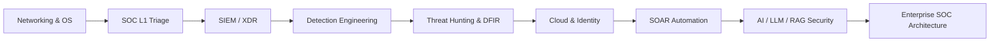
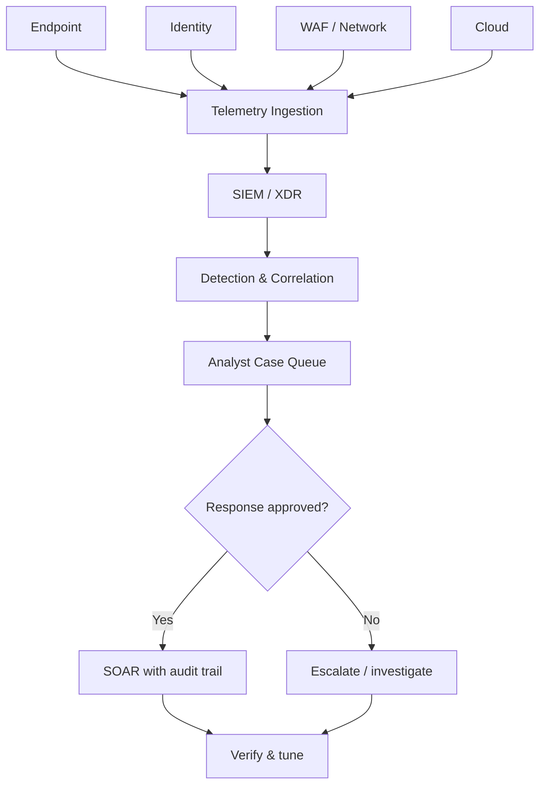

# 🛡️ Enterprise Security Operations & AI Security Roadmap

### Ultimate SOC Analyst Roadmap · L1 → L2 → L3 → Detection Engineer → SOC Architect

**Learn the signals · Investigate the threat · Engineer the detection · Secure the AI stack**

**A visual, practical, enterprise-oriented learning platform for modern blue teams.**

## 🚀 Explore the new enterprise learning tracks

| Track | What you will learn | Outcome |
|---|---|---|
| [Enterprise SOC Operations](modules/11-Enterprise-SOC-Operations.md) | Triage, SLAs, escalation, SOC metrics | Run a measurable SOC workflow |
| [Detection Engineering](modules/12-Detection-Engineering.md) | KQL, SPL, Sigma, testing, tuning | Build a reviewable detection pack |
| [Sentinel & Defender XDR](modules/13-Microsoft-Sentinel-Defender-XDR.md) | SIEM/XDR correlation, endpoint investigations | Investigate cross-platform incidents |
| [Splunk, SentinelOne & Akamai](modules/14-Splunk-SentinelOne-Akamai.md) | SIEM, EDR, WAF investigations | Correlate security telemetry |
| [Identity & Cloud Security](modules/15-Identity-Cloud-Security.md) | AD, Entra, AWS, Azure, GCP | Investigate identity/cloud abuse |
| [Vulnerability & Exposure Management](modules/16-Vulnerability-Exposure-Management.md) | KEV, EPSS, patch risk, exceptions | Prioritize exploitable exposures |
| [DFIR & Threat Hunting](modules/17-DFIR-Threat-Hunting.md) | Evidence, timelines, hunt hypotheses | Produce defensible case reports |
| [SOAR & Automation](modules/18-SOAR-Security-Automation.md) | Cortex XSOAR, APIs, approvals | Build safe workflows |
| [AI / LLM / RAG / Agent Security](modules/19-AI-LLM-RAG-Agent-Security.md) | Prompt injection, RAG poisoning, tool permissions | Assess AI application risks |
| [SOC Architecture](modules/20-Enterprise-SOC-Architecture.md) | Ingestion, resilience, governance | Design enterprise SOC platforms |
| [Labs & Projects](modules/21-SOC-Labs-Projects.md) | End-to-end blue-team portfolio | Demonstrate practical skills |
| [Career & Certifications](modules/22-SOC-Career-Certifications.md) | L1–L3 skill matrix and interviews | Track professional growth |

## 🗺️ Visual learning journey

## 🔐 Modern SOC architecture

## 🧪 Portfolio project milestones

| Project | Build | Validation evidence |
|---|---|---|
| SOC Operations Dashboard | Offline dashboard on synthetic incidents | Screenshots and filter checks |
| Sentinel + Defender Investigation | KQL hunting and event timeline | Positive/negative test records |
| Exposure Prioritization | Risk-based patch dashboard | Documented scoring assumptions |
| SOAR Approval Workflow | Enrichment and approval simulation | Audit log and rollback scenario |
| AI RAG Security Lab | Test retrieved-content injection defenses | Evaluation results and limitations |

> **Safety:** These are proposed learning resources. Queries and labs remain **UNTESTED** until executed in an authorized environment. Never use real customer data or credentials in public examples.
