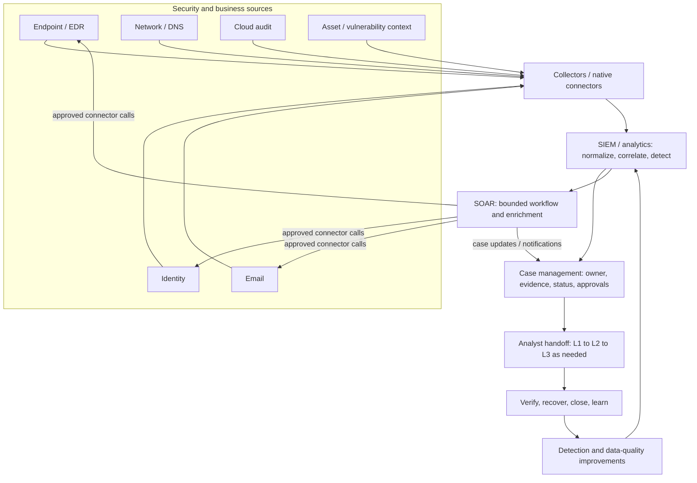

# SOC L1, L2, and L3 operations guide

This guide expands the SOC progression in the [role-based learning roadmap](README.md). It describes a practical, defensive operating model: how an alert moves through the SOC, what each tier owns, which tools commonly participate, and how the systems integrate. Product names are examples, not requirements; capabilities and permissions vary by organization and licensing.

Use synthetic data or environments you are authorized to monitor. Follow your organization's incident command, privacy, evidence-handling, and change-approval policies. Job titles and tier boundaries differ between teams: the local runbook, on-call arrangement, and named decision authority always take precedence.

## 1. SOC purpose and operating model

A Security Operations Center (SOC) monitors security-relevant telemetry, investigates suspicious activity, coordinates approved response, and improves the organization's ability to prevent, detect, respond to, and recover from incidents. It does not work in isolation: IT operations, identity, cloud, networking, application owners, privacy, legal, communications, and business leadership may all have responsibilities during an incident.

A common model has three analyst tiers:

| Tier | Primary purpose | Typical ownership |
|---|---|---|
| L1 — Triage / monitoring | Establish whether an alert is valid, prioritize it, gather initial context, document, and route or escalate. | Queue health, first response, routine cases, accurate handoff. |
| L2 — Investigation / response | Correlate evidence across sources, determine likely scope and impact, coordinate approved containment, and manage the case through resolution or handoff. | Investigation plan, incident scope, technical coordination, response recommendations. |
| L3 — Senior analyst / incident lead | Direct complex or high-impact investigations, resolve ambiguity, coordinate incident command and specialists, and ensure recovery and learning. | Incident strategy, decision log, executive/technical communication, after-action follow-up. |

These are capability levels, not a rule that every case must pass through all three. A clear, low-risk alert may be closed at L1 under documented criteria. A high-impact event may be escalated directly to the incident lead and relevant responders while L1 preserves the initial evidence and case context.

## 2. End-to-end alert and incident flow

```mermaid
flowchart LR
    A[Sources generate telemetry] --> B[Collectors and integrations ingest events]
    B --> C[Normalize, enrich, retain, monitor source health]
    C --> D[Detection analytics create alert]
    D --> E[Case queue: deduplicate, assign, prioritize]
    E --> F[L1 validate and triage]
    F -->|Benign / expected, criteria met| G[Document disposition and close]
    F -->|More investigation needed| H[L2 investigate and scope]
    F -->|Urgent / high impact| J[L3 or incident lead notified]
    H -->|Contained routine case| K[Coordinate authorized response]
    H -->|Complex, broad, uncertain, or high impact| J
    J --> K
    K --> L[Verify outcome, monitor, recover]
    L --> M[Close with evidence and follow-up actions]
    M --> N[Detection tuning, lessons, metrics]
    N --> D
```



### Case lifecycle, step by step

1. **Generate and ingest telemetry.** Endpoints, identity providers, email systems, firewalls, DNS, cloud control planes, applications, and other approved sources produce events. Collectors or native connectors send them to a data platform. Source health, timestamps, access controls, retention, and ingestion delays matter; missing data is not evidence that an event did not occur.
2. **Normalize and enrich.** A SIEM or analytics platform maps fields into useful schemas and may add approved asset, identity, vulnerability, or business context. Preserve the original event and source/time provenance so analysts can tell observed facts from derived context.
3. **Detect and create an alert.** A rule, analytic, vendor detection, or user report identifies activity for review. An alert is a signal to investigate, not proof of compromise. A detection should have an owner, rationale, expected data, severity guidance, and response instructions.
4. **Create or update a case.** Case management assigns a unique identifier, owner, timestamps, priority, related alerts, evidence references, and a record of decisions. Deduplication should group repeated signals without discarding useful events.
5. **Triage at L1.** Confirm the alert is in scope, validate key fields and data quality, check the applicable runbook, assess urgency, collect safe initial context, record facts and gaps, and either resolve within authority or route it with a specific question and handoff.
6. **Investigate at L2.** Form and test reasonable hypotheses; correlate relevant identity, endpoint, network, email, application, and cloud records; establish a timeline; identify affected entities and possible impact; preserve evidence; and recommend proportionate next steps.
7. **Lead at L3 when warranted.** Establish the incident lead and objectives, coordinate technical and business stakeholders, set an update cadence, track decisions and risks, resolve conflicts in evidence or priorities, and ensure specialist, privacy, legal, or leadership engagement according to policy.
8. **Respond under authorization.** The system owner or designated incident authority approves disruptive actions as required. Examples include isolating an endpoint, revoking a session, restricting an account, changing a cloud permission, or affecting business traffic. Consider impact, reversibility, evidence preservation, alternatives, and rollback. Verify the change in its authoritative system rather than trusting an automation success message alone.
9. **Recover and close.** Confirm the risk is addressed, monitor for recurrence, return services to an approved state, document unresolved risks and ownership, and close only when the closure criteria are met. Capture lessons and follow-up work with owners and due dates.

## 3. Responsibilities and handoffs by tier

### L1 — Triage analyst

**Owns:** the first review and quality of the initial case record. L1 does not need to prove a full incident; it must make a defensible decision to close under policy, continue routine triage, or escalate promptly.

**Typical workflow:**

1. Acknowledge and claim the case according to queue priorities and service targets.
2. Read the analytic details and runbook. Confirm the alert identifier, affected user/asset/resource, event time and timezone, detection source, and available evidence.
3. Check source health and basic consistency: correct entity, duplicate or related case, relevant maintenance/change notice, and whether required telemetry is present and timely.
4. Gather allowed context from SIEM/EDR/identity/email/asset views. Use approved enrichment only; record where it came from and when it was checked.
5. Decide among documented dispositions such as expected/benign, duplicate, needs more evidence, suspicious/escalate, or confirmed incident (only where criteria and authority permit). Do not label an event confirmed solely because a tool raised an alert.
6. Set or confirm priority using the organization's severity matrix. Consider asset criticality, identity privilege, evidence quality, potential impact, spread, and business context—not just the detection's default label.
7. Record a concise summary, facts, uncertainty, sources checked, actions taken, and why the case is being closed or escalated.
8. Escalate promptly for policy-defined high-risk conditions; request a specific L2 action and remain available for follow-up.

**L1 should escalate rather than guess** when impact may be material, a privileged or sensitive resource is involved, evidence suggests activity is ongoing or spreading, multiple independent sources corroborate concern, telemetry is materially incomplete, the runbook does not cover the case, or an action exceeds L1 authority. Local thresholds govern.

**Typical L1 deliverable:** a readable case with a one-paragraph summary; exact entities/time range; observed evidence and source references; checks performed; facts versus hypotheses; priority and rationale; missing information; disposition; and the next owner/action.

### L2 — Investigator / incident responder

**Owns:** an investigation with a clear question, scope, evidence trail, and recommended next steps. L2 commonly coordinates routine technical response but must use the organization's approval path for disruptive or business-impacting actions.

**Typical workflow:**

1. Accept the handoff; restate the question, severity, known facts, unknowns, and immediate safety or business constraints.
2. Define an investigation time window and entity set. Confirm clock/timezone considerations, identity mappings, asset ownership, and data-source limitations.
3. Build a timeline from relevant records. Correlate only data needed to test hypotheses; preserve identifiers, query context, source, and collection time so another analyst can reproduce the reasoning.
4. Examine related activity across authorized sources—for example, identity authentication and audit events, endpoint alert/process context in the vendor console, email message metadata, DNS/proxy/firewall records, and cloud audit records. Use approved read-only views and evidence collection processes.
5. Test alternative explanations such as approved maintenance, user travel, software updates, automation, shared devices, clock skew, or duplicate telemetry. State what would raise or lower confidence.
6. Scope potentially affected accounts, devices, resources, services, and time range. Distinguish confirmed, likely, possible, and not-yet-assessed scope. Avoid claiming absence where logs are unavailable.
7. Assess severity and business impact with service owners. Recommend containment, additional collection, or monitoring with rationale, risks, approval needs, and a verification plan.
8. Coordinate action with the authorized owner; preserve evidence consistent with policy; record approvals and results; reassess scope after each material finding.
9. Escalate to L3/incident command when impact, uncertainty, cross-team coordination, or decision authority exceeds the case's routine path.
10. Produce a closure or handoff summary, including root-cause confidence, residual risk, detection gaps, and follow-up owners.

**L2 should not:** perform unapproved containment, collect more personal or business data than necessary, alter evidence without recording it, treat a single indicator as conclusive, or hide uncertainty in a status update.

### L3 — Senior analyst / incident response lead

**Owns:** the investigation strategy and coordinated decision process for complex, high-impact, or ambiguous incidents. In some organizations L3 is an escalation specialist rather than the formal incident commander; identify the actual command authority explicitly.

**Typical workflow:**

1. Confirm incident declaration criteria, incident lead, decision authority, objectives, severity, and immediate safety/business priorities.
2. Establish roles and a communication channel: technical leads, SOC case owner, IT/service owners, identity/cloud/network responders, communications, privacy/legal, and leadership as needed. Limit sensitive information to appropriate channels.
3. Set a common operating picture: confirmed facts, hypotheses, scope, evidence gaps, affected services, business impact, actions underway, risks, and next update time.
4. Direct investigation priorities and specialist support. Resolve conflicting interpretations by identifying the evidence and assumptions behind each view; maintain a decision and action log.
5. Approve or route decisions according to the organization's authority matrix. Compare containment options, operational impact, reversibility, evidence preservation, dependencies, and rollback before action.
6. Coordinate containment, recovery, and validation; ensure critical services and stakeholders receive appropriate updates; revisit severity and incident scope as evidence changes.
7. Ensure evidence handling and records meet organizational, contractual, privacy, and legal requirements. Involve qualified forensic or legal specialists when required.
8. Lead transition from response to recovery and post-incident review. Assign corrective actions with accountable owners, due dates, measures of completion, and risk acceptance where relevant.

**L3 deliverables:** incident objectives and roles; a time-stamped decision/action log; periodic situation summaries; an agreed scope and confidence statement; approved response plan and verification; recovery/closure criteria; and an after-action report with tracked improvements.

## 4. Severity, priority, and escalation

Severity describes the assessed impact/risk; priority also accounts for urgency, response targets, and available resources. Use the organization's approved matrix. Do not equate vendor alert severity with incident severity.

A useful assessment considers:

- **Impact:** confidentiality, integrity, availability, safety, financial or regulatory consequences, and critical service dependency.
- **Scope:** number and type of users, endpoints, cloud resources, applications, and locations; whether activity is isolated or expanding.
- **Confidence:** source reliability, corroboration, alternative explanations, and gaps.
- **Urgency:** whether activity may be continuing, a time-sensitive exposure exists, or delay could materially increase harm.
- **Context:** privileged identities, sensitive data, critical assets, business calendar, known changes, and service-owner input.

Every severity level should define examples, who must be notified, target acknowledgement/update intervals, escalation route, required approvals, and closure authority. On-call details and exact response targets belong in internal runbooks, not assumed universal values.

Escalate immediately through the designated route when policy-defined critical conditions are met, when there is plausible ongoing high-impact activity, when containment authority is unclear, when evidence may be lost, or when legal/privacy/safety obligations may apply. If the normal owner is unavailable, use the documented backup path and record the attempted contacts.

## 5. Tooling: what each category does

A SOC is a workflow and people model supported by tools; buying every product category is not necessary. Start with the problem, required evidence, ownership, integration, and control requirements.

| Tool category | Role in the workflow | Common examples / notes |
|---|---|---|
| SIEM / security data analytics | Ingest, search, correlate, alert, dashboard, and retain security events. | Microsoft Sentinel, Splunk Enterprise Security, Elastic Security, Google Security Operations. Query languages and schemas differ. |
| EDR / XDR | Provide endpoint detection and investigation context; may also cover identity, email, or cloud signals. | Microsoft Defender XDR, CrowdStrike Falcon, SentinelOne, Cortex XDR. Use approved investigation and response features under policy. |
| Case management / ticketing | Assign ownership, capture evidence references, decisions, approvals, handoffs, and closure. | ServiceNow, Jira Service Management, TheHive, or a SIEM-native case system. Define a system of record and stable case identifiers. |
| SOAR / workflow automation | Orchestrate enrichment, routing, notifications, and controlled actions across integrations. | Microsoft Sentinel playbooks/Logic Apps, Splunk SOAR, Cortex XSOAR, Shuffle. Start with low-risk read-only workflows and audit every action. |
| Identity and access security | Investigate sign-ins, authentication controls, account changes, privileged roles, and sessions. | Entra ID, Okta, on-prem directory services, identity governance/PAM tools. Identity logs and authoritative user/device identifiers are important. |
| Email security | Investigate reported messages, delivery scope, message authentication/verdicts, and approved remediation. | Microsoft Defender for Office 365, Proofpoint, Mimecast, or provider-native controls. Preserve message identifiers and follow approved handling procedures. |
| Network telemetry | Add DNS, proxy, firewall, flow, VPN, and network detection context. | Firewalls, secure web gateways, DNS services, Zeek, network detection tools. Metadata coverage and retention vary; avoid assuming payload visibility. |
| Cloud security and audit | Provide control-plane audit, posture, workload, identity, and resource context. | AWS CloudTrail/GuardDuty, Microsoft Defender for Cloud, Azure activity logs, Google Cloud Audit Logs/SCC. Respect account boundaries and provider-specific semantics. |
| Asset, vulnerability, and configuration data | Establish owner, criticality, exposure, software, and known risk context. | CMDB, EASM, vulnerability management, cloud asset inventory, configuration management. Record data freshness and confidence. |
| Threat intelligence / enrichment | Add vetted context to an investigation. | Internal intel, vendor feeds, and approved reputation services. A match is context, not proof; consider freshness, provenance, and sharing/privacy constraints. |
| Forensics and evidence storage | Collect and preserve evidence under approved process, with integrity and access controls. | Organization-approved endpoint/cloud forensic tooling and restricted evidence repositories. Follow legal, privacy, and chain-of-custody requirements. |
| Collaboration / communications | Coordinate responders and provide controlled status updates. | Approved incident channels, paging/on-call systems, status tools, and secure documentation. Keep sensitive details in authorized locations. |

## 6. How the tools integrate

A typical data and control flow is:



**Integration principles:**

- Use stable identifiers for cases, users, devices, cloud resources, and alerts; document identity-resolution limits.
- Normalize timestamps and retain source timestamps, ingestion timestamps, timezone, and source identifiers. Monitor clock skew and connector delay.
- Keep raw/source evidence available as permitted; distinguish source facts from enrichment, analytic conclusions, and analyst hypotheses.
- Give connectors service identities with least privilege, managed credentials, rotation, scoped permissions, and audit. Separate read-only investigation permissions from response permissions.
- Make automation idempotent where possible; handle duplicates, stale inputs, timeouts, rate limits, partial failures, retries, and connector outages safely.
- Require named human approval for disruptive or uncertain actions unless a formally approved policy explicitly says otherwise. Include a bounded scope, rollback plan, and verification step.
- Avoid sending sensitive information to unapproved external enrichment or collaboration services. Minimize data and honor retention and access controls.
- Monitor telemetry freshness, ingestion volume, parsing failures, source outages, dropped fields, automation failures, and case synchronization. A dashboard should identify blind spots, not imply complete visibility.
- Version-control detection and playbook changes where feasible; peer-review, test with synthetic fixtures, stage rollout, and retain rollback capability.

## 7. Case notes and handoff template

Use the organization's case system. A useful structure is:

```text
Case / alert ID:
Current owner and next owner:
Status, priority, and reason:
One-sentence summary:
Question to answer / reason for escalation:
Entities and time range (include timezone):
Confirmed observations (source, event/reference ID, observed time):
Assessment and confidence:
Hypotheses and alternative explanations:
Sources checked and queries/views used (according to policy):
Known gaps, delayed sources, or conflicting timestamps:
Actions taken, by whom, when, approval, result, and verification:
Business/service owner and impact context:
Recommended next steps and required decision:
Next update / acknowledgement target from local policy:
Closure criteria or handoff acceptance:
```

A good handoff answers: **What happened? What do we know? What do we not know? What has already been done? What decision or action is needed next, by whom, and by when?**

## 8. Example: suspicious sign-in alert

This is a fictional training example; the alert itself is not proof of account compromise.

1. **L1 validates:** confirm the user/resource, event time, source health, analytic details, and applicable runbook. Check relevant approved identity context and duplicates. Record evidence and uncertainty. If indicators meet escalation criteria, route promptly rather than taking an unauthorized account action.
2. **L1 hands off:** provide the sign-in event reference, time window, identity/device context available, what was checked, missing data, priority rationale, and a specific investigation question.
3. **L2 investigates:** correlate relevant identity audit and application records; review associated endpoint context where authorized; compare with expected activity and approved changes; build a timeline; identify possible scope and confidence. Consult the service or identity owner as required.
4. **L2 recommends:** describe options, impact, evidence, approval requirement, and how success will be verified. Do not infer that a changed sign-in pattern alone proves account takeover.
5. **L3 leads if criteria warrant:** coordinate identity, service, privacy/legal, communications, and leadership roles as appropriate; establish objectives and update cadence; log decisions and approve or route actions according to authority.
6. **Authorized responder acts:** any session or account restriction follows policy and named approval. Verify the resulting state in the identity system, assess user/service impact, and monitor for recurrence.
7. **Close and improve:** record outcome and residual uncertainty, preserve required evidence, assign detection or process improvements, and communicate closure through approved channels.

## 9. Metrics and continuous improvement

Use a balanced set of measures; metrics should improve service and data quality, not incentivize premature closure.

- **Operations:** alert/case volume by source and severity, queue age, coverage, handoff volume, workload, and cases reopened.
- **Timeliness:** acknowledgement and update targets, time to escalation, investigation duration, approval wait time, and time to verified containment—defined consistently and interpreted with case complexity.
- **Quality:** sampled case-note completeness, escalation appropriateness, evidence/source attribution, closure quality, peer-review findings, and stakeholder feedback.
- **Detection/data health:** source coverage and freshness, parsing/field quality, analytic test results, false-positive patterns, detection gaps, and telemetry cost/retention.
- **Response/automation:** playbook completion and error rates, verified versus unverified actions, approval and rollback rates, duplicate/replay behavior, and unintended-impact reviews.
- **Learning:** after-action items completed, recurring incident themes, runbook freshness, and detection improvements validated in tests.

Define metric names, denominators, exclusions, owners, and review cadence. Do not use a single time-to-close number as a proxy for investigation quality.

## 10. Learning progression and practice

1. **Foundation:** read sample Windows, Linux, identity, network, and cloud audit records; explain timestamps, fields, entities, and data limitations.
2. **L1 practice:** use synthetic alert records to create a triage note, assign a priority using a supplied matrix, and make a justified close/escalate decision.
3. **L2 practice:** combine a few synthetic sources into a timeline; separate facts from hypotheses; document scope, confidence, missing evidence, and a proportionate recommendation.
4. **L3 practice:** run a tabletop with role cards, decision points, an incident log, stakeholder updates, approval steps, recovery criteria, and after-action items.
5. **Integration practice:** draw a data-flow diagram from sources to SIEM, case management, and SOAR; list each connector's purpose, permissions, failure modes, data handling, and verification.
6. **Readiness check:** explain why each action is authorized, what evidence supports it, what remains unknown, who owns the next decision, and how outcome will be verified.

Related guides: [scenario-driven alert triage](../SOC/ALERT-TRIAGE.md) and [SOC automation and SOAR framework](../SOC/AUTOMATION-FRAMEWORK.md).
