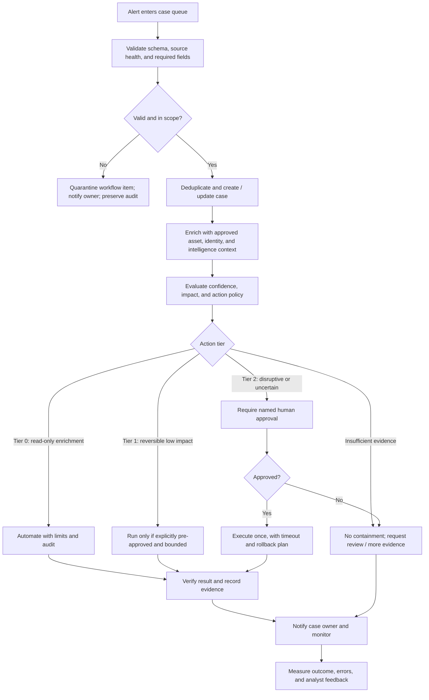

# SOC automation and SOAR framework

Automation should reduce repetitive work without removing accountability. Start with enrichment, routing, deduplication, evidence capture, and notifications. Add response actions only after testing, risk review, ownership, approval rules, monitoring, and rollback are established.

## Reference workflow

## Action tiers

| Tier | Examples | Guardrails |
|---|---|---|
| 0 — Read-only | Add asset/identity context, check duplicate cases, collect approved reputation metadata, summarize event fields. | Minimize data; source and timestamp provenance; rate limits; do not turn weak context into a verdict. |
| 1 — Bounded, reversible | Create a case, notify an owner, add a temporary label, request analyst review. | Explicitly pre-approved scope, idempotency, timeout, audit trail, owner and reversal path. |
| 2 — Disruptive | Isolate endpoint, disable/restrict account, block business traffic, remove messages, change cloud permissions. | Named approval and policy-defined authority; assess business impact; preserve evidence; rollback/recovery plan; verify outcome. |

## Playbook design checklist

- [ ] Trigger, purpose, owner, supported alert types, and out-of-scope conditions are clear.
- [ ] Required fields are validated; malformed or stale inputs fail closed to review.
- [ ] Every connector uses least privilege, managed credentials, rotation, and access audit.
- [ ] Enrichment sources, privacy limits, provenance, and API rate limits are documented.
- [ ] Duplicate and replay behavior is safe; operations are idempotent where possible.
- [ ] Decision branches and confidence thresholds are understandable and tested.
- [ ] Human approval is required for disruptive actions and approval identity is recorded.
- [ ] Timeouts, retries, partial failures, cancellation, and rollback are handled.
- [ ] Results are verified from the target system, not inferred from an API success response alone.
- [ ] A dry-run mode, test fixtures, peer review, staged release, and rollback are available.
- [ ] Playbook performance, error rates, false actions, and user impact are monitored.

## Test plan

Test benign events, known positive training events, missing fields, duplicate alerts, stale events, unavailable connectors, expired credentials in a sandbox, rate limiting, partial completion, denied approval, cancellation, and target-system verification failure. Keep tests isolated and use synthetic records. Do not validate response by disrupting production systems.

## Operations and metrics

Track playbook invocation count, completion and failure rates, enrichment latency, cases requiring manual correction, approval wait time, verified versus unverified actions, rollback frequency, and user/service impact. Review unexpected actions immediately. Define a kill switch and manual operating procedure. Reassess permissions and playbook ownership regularly.

## Example scenario: suspicious sign-in alert

1. Validate identity, event timestamp, and connector health.
2. Enrich the case with approved user, device, and asset context; retain source attribution.
3. Search authorized logs for related events and create a concise evidence summary.
4. Route to the analyst with uncertainty and missing data explicitly stated.
5. If policy supports a response, require the designated approval before session or account changes.
6. Verify action state from the identity system, notify the owner, and monitor for recurrence.
7. Record decision and outcome; tune the playbook based on reviewed cases.

## Platform-neutral implementation mapping

The same controls apply whether implementing a workflow with Microsoft Sentinel Automation/Logic Apps, Splunk SOAR, Cortex XSOAR, Shuffle, TheHive integrations, or another platform. Check current product documentation, licensing, connector behavior, and identity model before implementation. This guide deliberately specifies safe design outcomes rather than a click-by-click production deployment.
