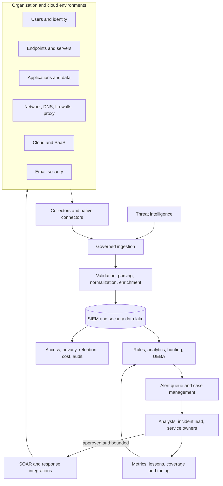

# SOC reference architecture

This guide gives a vendor-neutral starting point for designing a defensive SOC. It is not a prescriptive bill of materials. Select capabilities from business requirements, threat model, existing platforms, data residency, staffing, resilience, and cost. See [topic workflow diagrams](../DIAGRAMS/DOMAIN-FLOWS.md) for source-to-platform flows.

## Design requirements first

Record business services and owners; likely risks and threat scenarios; regulatory/privacy obligations; operating hours and response commitments; data sources and expected volumes; availability and recovery requirements; analyst skills; retention; budget; and who may authorize containment. Define measurable service objectives before choosing a SIEM or SOAR product.

## Logical architecture

## Deployment patterns

| Pattern | Appropriate considerations | Common design priorities |
|---|---|---|
| Small SOC / lean team | Limited staffing and budget; prioritize a small set of high-value sources and clear escalation paths. | Managed services where appropriate, simple ownership, alert quality, backup coverage, documented playbooks. |
| Medium SOC | Multiple teams, business units, and varied technology. | Source onboarding standards, role-based access, case routing, service ownership, tiering, data lifecycle and measurable SLAs. |
| Enterprise SOC | Many regions, critical services, large telemetry volumes, complex governance. | Resilience, data partitioning/residency, federated ownership, detection-as-code practices, 24/7 operating model, change governance and cost controls. |
| MSSP / multi-tenant SOC | Separate customers, contracts, jurisdictions, and response authority. | Strong tenant isolation, customer-specific authorization, auditable access, clear shared responsibility and no cross-tenant data leakage. |
| Hybrid SOC | Mix of on-premises, cloud, remote workforce, and managed services. | Consistent identity and asset context, secure connectors, network boundaries, unified case process, resilient collection. |
| Cloud-native SOC | Cloud control-plane, identity, workloads, containers, serverless, SaaS. | Native audit coverage, least-privilege connectors, account/subscription boundaries, data residency, ephemeral workload context and provider-specific response approvals. |

## SOC capability layers

1. **Sources:** users/identity, endpoints, servers, business applications, cloud/SaaS, network devices, firewalls, DNS/proxy, email and security controls.
2. **Collection:** approved agents, forwarders, APIs, native connectors, collectors and queues; monitor health and protect credentials.
3. **Data pipeline:** parsing, schema validation, normalization, deduplication, enrichment, time synchronization, quality checks and dead-letter handling.
4. **Analytics:** rules, correlation, behavioral analytics and hunting. Each analytic should state required fields, expected behavior, exclusions, test data, owner and response.
5. **Operations:** alert queue, case management, analyst handoffs, incident command, communications, evidence handling and recovery.
6. **Response:** approved integrations to endpoint, identity, network, cloud and email controls. Prefer bounded, reversible actions; require explicit approval for disruptive actions.
7. **Governance:** access control, audit, privacy, retention, legal holds, residency, data minimization, vendor risk and cost management.
8. **Improvement:** detection quality, source health, incident outcomes, lessons learned, tabletop exercises, tuning and architecture review.

## Resilience and failure modes

For each source and component, specify owner, expected event rate, latency, critical fields, health signal, buffering behavior, outage alert, recovery procedure, access dependency, retention and cost. Test connector credential expiry, ingestion delay, malformed events, duplicate events, partial cloud outages, SIEM access failure, and case-routing failure. Document the manual fallback and how to reconcile missed data after recovery.

## SOC measures

Use a balanced scorecard, not a single speed metric. Examples include source coverage and freshness; percentage of critical assets with expected telemetry; detection test pass rate; alert precision and analyst rework; time to acknowledge and investigate by severity; case completeness; response approval and verification rates; playbook failure rate; retention/cost; and overdue post-incident actions. Define the denominator and exclusions for every metric.

## Architecture review checklist

- [ ] Business services, owners, threat scenarios, and assumptions are documented.
- [ ] Every source has an owner, purpose, access model, retention, quality checks, and outage path.
- [ ] Identity, asset criticality, environment, and time context can be correlated with events.
- [ ] Tenant boundaries, trust boundaries, data residency, privacy, and privileged access are explicit.
- [ ] Detection content has tests, version history, owner, response guidance, and rollback.
- [ ] SOAR actions are risk-tiered, bounded, logged, idempotent where possible, and approved appropriately.
- [ ] Staffing, escalation, handover, incident command, and business communications are defined.
- [ ] Resilience, recovery, cost, and operational ownership are tested, not merely diagrammed.
- [ ] Architecture decisions and exceptions have rationale, owner, review date, and expiry where appropriate.
