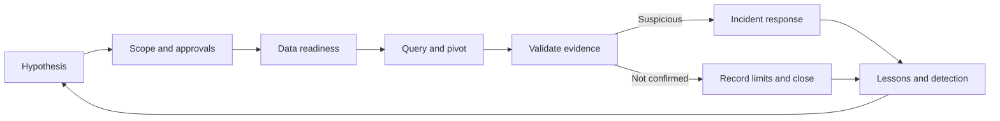

# <span style="color:#00C2FF">Threat Hunting Field Guide</span>

> A practical, evidence-led guide to proactive defense. Hunt only within environments where you have explicit authorization and approved access to telemetry.

## <span style="color:#32D74B">1. What Threat Hunting Is</span>

Threat hunting is a structured search for suspicious activity that existing alerts may not have identified. A hunt begins with a question or hypothesis, uses available evidence to test it, and ends with a documented conclusion or a detection improvement. It complements—not replaces—alert monitoring, incident response, and vulnerability management.

### Outcomes
- Confirm or reasonably discount a hypothesis
- Identify affected accounts, devices, applications, or data
- Find telemetry or detection gaps
- Produce a tested analytic, response recommendation, or follow-up question

## <span style="color:#FFB000">2. Hunt Lifecycle</span>



1. **Hypothesize:** State a behavior, affected population, and reason to investigate.
2. **Scope:** Set time range, tenant, systems, identities, privacy constraints, and authorization.
3. **Check data:** Confirm source coverage, event time, ingestion delays, retention, and schema.
4. **Baseline:** Compare with peer groups, business cycles, approved tools, and change records.
5. **Hunt:** Start broad, narrow by evidence, and preserve the query and its parameters.
6. **Validate:** Corroborate across independent sources; separate observed facts from inference.
7. **Escalate:** Use the incident process for credible compromise; do not make disruptive changes without authority.
8. **Improve:** Document false positives, visibility gaps, and a tested detection or collection action.

## <span style="color:#FF5F57">3. Methodologies</span>

| Method | Starting point | Useful for |
|---|---|---|
| MITRE-based | ATT&CK behavior and coverage gap | Measuring defensive visibility |
| IOC-led | Trusted indicator with provenance and expiry | Checking exposure to known infrastructure/files |
| Behavioral | Anomalous sequence, not a single indicator | Novel or changing adversary behavior |
| Identity | Sign-ins, privileges, tokens, directory changes | Account compromise and privilege misuse |
| Cloud | Control-plane audit, workload, identity, network | API misuse, drift, and exposed resources |
| EDR | Process, file, registry, service, and network telemetry | Endpoint execution and persistence investigation |
| Network | DNS, proxy, flow, firewall, IDS/NDR | Command-channel and unusual data movement clues |
| Anomaly | Deviation from a justified baseline | Rare activity, with context to limit false positives |

### Hypothesis template
> We believe **[behavior]** may occur on **[population]** during **[time window]**, because **[evidence or threat context]**. We will examine **[data sources]**, compare against **[baseline]**, and escalate if **[validation criteria]** are met.

## <span style="color:#7C3AED">4. Data and Investigation Quality</span>

- Normalize timestamps to UTC while retaining original timestamps and time zones.
- Record source, query, filters, time window, analyst, and result count.
- Validate identity and device resolution; watch for reused names and NAT/shared egress.
- Check ingestion health before interpreting an empty result as evidence of absence.
- Preserve relevant evidence according to policy; restrict sensitive data to need-to-know access.
- Correlate endpoint, identity, DNS/proxy, email, cloud audit, and change-management records.
- Use approved test tenants or synthetic data to validate queries before operational use.

## <span style="color:#00D4AA">5. Hunt Catalog: 100 Scenarios</span>

These are defensive hypotheses and investigation prompts, not verdicts. Adapt them to your environment, telemetry, retention, and approved procedures. A match is a lead to validate, not proof of compromise.

| ID | Hunt hypothesis / starting question | Useful evidence |
|---|---|---|
| H001 | Interactive logon to a server by an account that normally uses workstations | Sign-in, host role, account baseline |
| H002 | Successful sign-in follows a burst of failures for the same identity | Authentication, source, risk, MFA |
| H003 | One source produces failures across many identities | IdP/AD auth, proxy, source reputation |
| H004 | One identity signs in from geographically or operationally implausible locations | IdP sign-in, device, session details |
| H005 | Privileged account authenticates from an unmanaged or newly enrolled device | IdP, device compliance, PAM |
| H006 | New MFA method or recovery detail is added before sensitive access | Identity audit, sign-in history |
| H007 | MFA denials or repeated prompts precede a successful authentication | MFA audit, session and user confirmation |
| H008 | Dormant or disabled identity becomes active or authenticates | Directory and IdP lifecycle events |
| H009 | Service account performs interactive or workstation-style logon | AD/IdP, endpoint, service ownership |
| H010 | Legacy authentication appears for an identity expected to use modern auth | IdP protocol, conditional access |
| H011 | Privileged group membership changes outside approved workflow | Directory audit, ticket/change records |
| H012 | New account receives high-impact roles soon after creation | Identity lifecycle and role audit |
| H013 | Role elevation is unusually broad, long-lived, or unapproved | PIM/PAM events, approvals, audit log |
| H014 | Authentication token or session persists beyond normal policy | IdP session, device and policy events |
| H015 | Account signs in after termination or access removal | HR lifecycle, directory, sign-in logs |
| H016 | Unusual Kerberos ticket patterns for an account or service | DC security events, SPNs, baseline |
| H017 | NTLM usage rises or appears on a sensitive server | DC logs, endpoint network telemetry |
| H018 | Directory replication privileges or operations are atypical | Directory audit, DC-to-DC flows |
| H019 | Sensitive directory attributes change without a matching change record | Directory service changes, change system |
| H020 | New trust, federation, or identity-provider configuration is introduced | Directory/IdP admin audit |
| H021 | Office application launches an uncommon script interpreter or child process | EDR process lineage, signed binary context |
| H022 | Scripting engine execution is rare for the user or device role | EDR, command metadata, admin inventory |
| H023 | Process runs from a user-writable or temporary path on a managed endpoint | EDR file/process, prevalence |
| H024 | Rare or unsigned binary executes on a high-value server | EDR, software inventory, change record |
| H025 | A trusted administration utility behaves outside its approved purpose | EDR lineage, user role, maintenance window |
| H026 | Browser or document reader spawns an unexpected child process | EDR lineage, email and download telemetry |
| H027 | New service installation is followed by unusual network activity | EDR, Windows security logs, flow data |
| H028 | Scheduled task creation or modification lacks an owner or approved change | Endpoint telemetry, task metadata |
| H029 | Startup configuration changes on a sensitive endpoint | EDR, registry/config audit, change record |
| H030 | WMI or remote management activity originates from a non-admin workstation | EDR, Windows logs, network flows |
| H031 | Security tooling is stopped, disabled, or has coverage gaps | EDR health, policy, endpoint events |
| H032 | New local administrator or privileged local group membership appears | Endpoint identity events, inventory |
| H033 | Unusual use of sudo or privileged shell on Linux | auth/audit logs, command lineage, owner |
| H034 | New cron/systemd startup configuration appears unexpectedly | File integrity, auditd, change records |
| H035 | SSH access or keys change for sensitive Linux accounts | auth logs, file audit, key management |
| H036 | Rare executable runs with elevated permissions or unusual parent | Linux EDR, auditd, package provenance |
| H037 | Host firewall or endpoint security configuration changes | Configuration management, audit logs |
| H038 | New local account or group is created on a production host | OS audit, identity inventory, change record |
| H039 | macOS launch agent/daemon or security preference changes unexpectedly | Endpoint telemetry, MDM, file audit |
| H040 | Endpoint process accesses a high volume of sensitive files unexpectedly | EDR, DLP, user role, file audit |
| H041 | DNS queries show unusual volume, entropy, or record-type distribution | Resolver logs, endpoint, domain age |
| H042 | Internal systems query newly observed or low-prevalence domains | DNS, threat intel, asset role |
| H043 | Endpoint repeatedly contacts a destination at regular intervals | DNS, proxy, firewall, EDR network events |
| H044 | Direct-to-IP or unusual port traffic bypasses normal egress paths | Netflow, firewall, proxy policy |
| H045 | Large outbound transfer occurs outside normal workload patterns | Proxy/flow, data classification, owner |
| H046 | East-west connections cross a segment boundary unexpectedly | NDR/flow, firewall policy, asset inventory |
| H047 | A sensitive server receives remote admin connections from unusual sources | Firewall, EDR, identity, change window |
| H048 | TLS certificate or destination characteristics are anomalous for an application | Proxy/TLS metadata, app owner, baseline |
| H049 | Repeated connection failures or traffic spikes target a critical service | Firewall/NDR, availability monitoring |
| H050 | DNS, proxy, and endpoint evidence disagree about a connection | EDR, resolver, proxy, clock/coverage checks |
| H051 | Mailbox forwarding or inbox rules are newly created or changed | M365 audit, mailbox owner, admin change |
| H052 | Unusual mailbox access follows a risky sign-in | Mail audit, IdP, session and device evidence |
| H053 | OAuth consent or application permission is unusually broad | Entra audit, app inventory, owner approval |
| H054 | New service principal credential or secret is added unexpectedly | Cloud/IdP audit, secret owner, change record |
| H055 | Mailbox export, bulk access, or download pattern differs from baseline | Unified audit, workload logs, user role |
| H056 | External sharing or anonymous links are created for sensitive content | SharePoint/Drive audit, classification, owner |
| H057 | Email campaign targets a role or group with anomalous link/attachment patterns | Email security, click logs, user reports |
| H058 | User reports a message after a related link click or sign-in | Mail, web proxy, IdP session, endpoint |
| H059 | Mail transport or anti-phishing policy is changed unexpectedly | Admin audit, change control |
| H060 | Privileged role or mailbox delegation is added without an expected request | M365 audit, approvals, identity events |
| H061 | Cloud audit shows a privileged policy or role changed unusually | AWS/Azure/GCP control-plane audit |
| H062 | Audit logging, security monitoring, or alerting is disabled or altered | Cloud audit, configuration history |
| H063 | Public exposure changes on storage, database, or service resources | Cloud config, resource policy, owner |
| H064 | New access key, credential, or service identity is created unexpectedly | IAM audit, owner, usage and source |
| H065 | A workload identity gains permissions outside its service need | IAM graph, deployment record, audit |
| H066 | API calls originate from a new location, agent, or unusual time | Cloud audit, identity and network context |
| H067 | New compute, container, or serverless resource appears outside deployment workflow | Cloud inventory, CI/CD audit, owner |
| H068 | Security group, route, or firewall changes broaden exposure | Cloud network audit, IaC/change records |
| H069 | Secrets are accessed by a new principal or workload | Vault/KMS audit, identity, deployment |
| H070 | Cross-account or cross-project access is used unexpectedly | Cloud audit, trust policy, business context |
| H071 | Container workload runs an unapproved image or unexpected privileged settings | Registry provenance, orchestrator audit |
| H072 | Kubernetes role binding or cluster-admin access changes unexpectedly | Kubernetes audit, identity and deployment |
| H073 | New workload requests host-level access inconsistent with its role | Admission, runtime, deployment metadata |
| H074 | CI/CD identity accesses production outside a normal release window | Pipeline logs, cloud audit, approvals |
| H075 | Build artifact provenance or signing status changes unexpectedly | CI/CD, artifact registry, signing records |
| H076 | Source-control secrets or high-risk permission changes are detected | Secret scanning, repository audit |
| H077 | Third-party integration gains new scopes or credentials | SaaS audit, vendor inventory, approval |
| H078 | Backup protection or retention policy changes without approval | Backup audit, cloud control plane |
| H079 | Data store access volume or query pattern deviates from application baseline | Database audit, network, owner |
| H080 | Cloud resource deletion or encryption/config changes correlate with access anomalies | Control-plane audit, identity, workload |
| H081 | Threat-intel indicator appears in a telemetry source within its validity window | IOC source, first/last seen, confidence |
| H082 | Known-bad indicator match is inconsistent with expected business traffic | DNS/proxy/EDR, allowlist and ownership |
| H083 | Multiple weak indicators co-occur on the same host or identity | SIEM correlation, endpoint, identity |
| H084 | A newly observed file hash is rare and associated with suspicious behavior | EDR, prevalence, signer and source |
| H085 | IOC match is stale, low-confidence, or from an untrusted feed | Intel provenance, expiry, analyst review |
| H086 | Alert is repeatedly suppressed despite new related evidence | SIEM rules, suppression logic, case history |
| H087 | Detection coverage is absent for a prioritized ATT&CK behavior | Data inventory, analytic tests, ATT&CK mapping |
| H088 | Telemetry source stops sending or sharply changes event volume | Collector health, source inventory, pipeline metrics |
| H089 | Event parsing or schema changes create silent detection blind spots | Parser health, sample events, content tests |
| H090 | Clock skew or ingestion delay disrupts event correlation | Source clocks, pipeline latency, timestamps |
| H091 | Incident device or identity appears in related events beyond initial scope | Case graph, EDR, IdP, network, cloud |
| H092 | Similar activity occurs across multiple business units or tenants | Cross-tenant-safe aggregate telemetry |
| H093 | Remote support tool use is new, unapproved, or outside support hours | EDR, software inventory, ticket and owner |
| H094 | Admin activity occurs from a jump host with unusual session context | PAM, endpoint, identity, network |
| H095 | Data access occurs immediately after privilege elevation | IAM/PAM, file/database audit, session |
| H096 | New device registration precedes access to sensitive applications | IdP, MDM, app audit |
| H097 | Authentication or endpoint behavior changes after a policy exception | Change ticket, policy audit, risk events |
| H098 | AI application retrieves data beyond the user's expected authorization | AI gateway, identity, retrieval audit |
| H099 | AI prompt/output handling exposes sensitive content or bypasses intended policy | AI audit, DLP, access policy, review |
| H100 | An incident's indicators, timing, and behaviors suggest a related campaign | Case records, threat intel, ATT&CK, confidence |

## <span style="color:#FFB000">6. Platform Hunt Packs</span>

The following packs are **50 hunt mappings per platform** to the catalog above. They are hunt objectives and data-model mappings, not copy-paste production queries. Validate table availability, licensing, schema, retention, and tenant policy before implementation. Apply the same IDs in a work queue to prevent duplicate hunts.

### Microsoft Defender XDR — 50 hunt mappings

Use Advanced Hunting tables such as `IdentityLogonEvents`, `IdentityDirectoryEvents`, `DeviceLogonEvents`, `DeviceProcessEvents`, `DeviceNetworkEvents`, `DeviceFileEvents`, `DeviceRegistryEvents`, `EmailEvents`, `EmailUrlInfo`, `CloudAppEvents`, and `AlertInfo` as applicable to licensing and tenant configuration. Table names and columns can evolve; consult current product schema.

| IDs | Hunt focus |
|---|---|
| H001–H005 | Unusual server logons; failures then success; distributed failures; location anomalies; unmanaged privileged device |
| H006–H010 | New MFA/recovery detail; MFA denials; dormant account use; interactive service account; legacy authentication |
| H011–H015 | Privileged group changes; elevated new user; risky role elevation; unusual session persistence; post-termination access |
| H016–H020 | Kerberos anomalies; NTLM changes; replication-like behavior; directory attribute changes; trust/federation change |
| H021–H025 | Office-to-script lineage; rare scripting; writable-path execution; rare unsigned binary; admin tool deviation |
| H026–H030 | Browser/document child processes; new services; scheduled tasks; startup changes; unusual WMI/remote management |
| H031–H035 | Defender/EDR coverage loss; local admin changes; Linux sudo anomalies; cron/systemd changes; SSH key/access changes |
| H036–H040 | Elevated Linux process; host firewall changes; new local account; macOS launch item changes; unusual file access |
| H041–H045 | DNS anomalies; rare domains; periodic connections; direct-to-IP egress; unusual outbound volume |
| H046–H050 | Segment-crossing traffic; unusual remote admin; anomalous TLS metadata; service traffic spike; endpoint/network evidence mismatch |

### Microsoft Sentinel — 50 hunt mappings

Use the ASIM-normalized schemas where available, or workspace tables such as `SigninLogs`, `AuditLogs`, `SecurityEvent`, `DeviceProcessEvents`, `DeviceNetworkEvents`, `EmailEvents`, `CloudAppEvents`, and cloud-specific audit tables. Verify connector health and workspace retention.

| IDs | Hunt focus |
|---|---|
| H001–H005 | Server logon baseline; failures then success; multi-account failures; sign-in travel/device anomaly; privileged unmanaged sign-in |
| H006–H010 | MFA/security info change; repeated MFA denial; dormant identity use; service-account interactive logon; legacy authentication |
| H011–H015 | Privileged membership; new elevated account; PIM elevation; persistent session anomaly; terminated-user access |
| H016–H020 | Kerberos behavior; NTLM increase; replication privilege; directory change; federation/trust change |
| H021–H025 | Office child process; uncommon scripting; writable-path execution; rare binary; admin utility deviation |
| H026–H030 | Browser/document lineage; service install; task changes; startup configuration; remote management anomaly |
| H031–H035 | Sensor/logging health; local admin changes; sudo activity; cron/systemd changes; SSH key/access change |
| H036–H040 | Elevated Linux execution; firewall config change; new local identity; macOS launch config; sensitive file volume |
| H041–H045 | DNS behavior; rare/new domain; periodic outbound; direct egress; transfer baseline deviation |
| H046–H050 | East-west boundary; unusual remote admin; TLS/proxy metadata; service traffic spike; multi-source mismatch |

### Splunk — 50 hunt mappings

Use the CIM and data models where implemented (for example Authentication, Endpoint, Network Traffic, DNS, Email, and Change). Adapt to sourcetypes and field extractions; accelerated data models, index permissions, and retention affect results.

| IDs | Hunt focus |
|---|---|
| H001–H005 | Server logon baseline; failures then success; multi-account failure sources; location anomalies; privileged unmanaged device |
| H006–H010 | MFA factor change; repeated denied prompts; dormant account use; interactive service account; legacy auth |
| H011–H015 | Group membership changes; elevated new account; out-of-pattern role change; session persistence; leaver access |
| H016–H020 | Kerberos ticket anomalies; NTLM trend; replication-like activity; directory changes; trust/federation change |
| H021–H025 | Office-to-script process chain; rare scripts; writable-path execution; unsigned rare file; admin utility anomaly |
| H026–H030 | Browser/document child process; service install; task creation; startup change; WMI/remote admin anomaly |
| H031–H035 | Security sensor health; local admin changes; sudo; cron/systemd; SSH key/access change |
| H036–H040 | Privileged Linux process; firewall changes; new local account; macOS launch changes; unusual file access |
| H041–H045 | DNS entropy/volume; rare domain; beacon-like timing; direct egress; outbound transfer deviation |
| H046–H050 | Cross-segment traffic; unexpected admin connection; TLS/proxy anomaly; service traffic spike; source disagreement |

## <span style="color:#7C3AED">7. Operational Hunt Report</span>

```text
Hunt ID / title:
Hypothesis and business rationale:
Authorization, scope, and time window:
Data sources, coverage, and known gaps:
Query or analytic version and parameters:
Baseline / expected behavior:
Observed evidence (facts only):
Assessment and confidence:
Related identities, devices, cases, or ATT&CK techniques:
Actions taken / approvals / evidence references:
Detection or telemetry improvements:
Owner, next review date, and retention handling:
```

## <span style="color:#00D4AA">8. Metrics and Exit Criteria</span>

Track hypotheses tested, sources covered, time to validate, confirmed findings, false-positive drivers, detection improvements, and gaps assigned to an owner. A hunt is complete when its scope and limitations are documented, evidence is dispositioned, and follow-up work has an accountable owner. Do not equate no hits with proof that the behavior did not occur.

## <span style="color:#00C2FF">Further Study</span>

- MITRE ATT&CK and ATT&CK Navigator
- SigmaHQ rules and test datasets
- Microsoft Defender XDR Advanced Hunting documentation
- Microsoft Sentinel hunting documentation and ASIM
- Splunk CIM and Security Content
- NIST incident handling guidance
