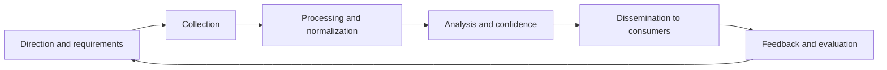
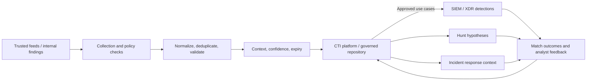

# <span style="color:#00C2FF">Threat Intelligence Operations Guide</span>

> Turn trustworthy, timely intelligence into better defensive decisions—not just a larger indicator list.

## <span style="color:#32D74B">1. Purpose and Scope</span>

Cyber threat intelligence (CTI) is analyzed information about threats, adversaries, capabilities, infrastructure, and intent that supports a specific decision. The value of intelligence comes from context, confidence, relevance, and timeliness. An indicator match alone is not a conclusion that a system is compromised.

### Intelligence questions
- Which threats are relevant to our sector, geography, technology, or mission?
- What behaviors should our SOC be able to observe and detect?
- Are our assets communicating with infrastructure of credible concern?
- What control, hunt, or response decision should change as a result?

## <span style="color:#FFB000">2. Intelligence Lifecycle</span>



1. **Direction:** define priority intelligence requirements, decision owners, scope, and cadence.
2. **Collection:** obtain relevant data from authorized internal and external sources.
3. **Processing:** normalize, deduplicate, enrich, classify, and record provenance.
4. **Analysis:** assess reliability, confidence, relevance, alternative explanations, and gaps.
5. **Dissemination:** deliver an actionable product in the right format and classification.
6. **Feedback:** measure utility, update requirements, expire stale data, and improve sources.

## <span style="color:#FF5F57">3. Intelligence Types</span>

| Type | Audience / horizon | Example output |
|---|---|---|
| Strategic | Executives; months to years | Risk trends, sector exposure, investment recommendations |
| Operational | Incident and campaign teams; days to months | Campaign analysis, adversary objectives, likely targeting |
| Tactical | SOC and engineering; weeks to months | TTP analysis, detection priorities, ATT&CK coverage |
| Technical | Analysts and platforms; hours to weeks | Validated indicators with context, confidence, and expiry |

## <span style="color:#7C3AED">4. Collection and Processing</span>

### Sources
- Internal incident, alert, DNS, proxy, endpoint, identity, cloud, and email telemetry
- Government and sector sharing groups, vendor advisories, CERTs, and trusted research
- Commercial and community feeds, with licensing and redistribution limits checked
- Malware analysis and sandbox results from approved isolated environments

### Processing controls
- Preserve source, collection time, first/last seen, confidence, and handling restrictions.
- Normalize domains, IPs, URLs, hashes, and timestamps; retain original values.
- Deduplicate while preserving source references and conflicting assessments.
- Enrich carefully; avoid sending sensitive internal artifacts to public services without authorization.
- Apply expiry and review rules. Indicators can be repurposed, reassigned, or become stale.

## <span style="color:#00D4AA">5. Indicator Types and Limitations</span>

| Indicator | Example use | Common caveat |
|---|---|---|
| Hash | File matching | Changes with file modification; not behavior coverage |
| IP address | Network observation | Shared hosting, CDN, VPN, and reassignment create false positives |
| Domain | DNS/proxy correlation | Ownership and hosting can change; lookalikes need context |
| URL | Specific resource matching | Often short-lived, private, or path-sensitive |
| Email | Sender, recipient, or campaign analysis | Display name and header identity may differ |
| File | Name, path, signer, or metadata | Names are easy to imitate; validate provenance and behavior |

Prefer behavior and relationship context over brittle single indicators. Do not block or disrupt based solely on a low-confidence feed match.

## <span style="color:#FFB000">6. Analysis and Confidence</span>

Assess:
- Source reliability and collection method
- Indicator or claim credibility
- Recency, first/last observation, and expected lifetime
- Relevance to organizational assets and exposure
- Corroboration across independent sources
- Benign explanations, shared infrastructure, and known business use
- Potential operational impact of acting on the intelligence

Use a documented confidence scale (for example, low/medium/high) with written criteria. Keep confidence distinct from severity and source reliability.

## <span style="color:#32D74B">7. Tools and Platforms</span>

| Tool | Typical role | Good practice |
|---|---|---|
| MISP | Sharing, events, attributes, and correlation | Govern sharing groups, tags, expiry, and provenance |
| OpenCTI | Knowledge graph and CTI workflow | Maintain source references, confidence, and entity relationships |
| VirusTotal | File/domain/IP context and reputation | Respect terms and privacy; upload only approved samples |
| GreyNoise | Context for internet-scanning IP activity | Treat as one signal and verify relevance to your environment |
| AlienVault OTX | Community threat intelligence and pulses | Assess publisher quality, age, confidence, and duplication |
| ThreatFox | Community malware-related indicator sharing | Validate context and expiry before operational use |

Tool capabilities, free tiers, licensing, and API terms change; verify current vendor documentation before integration.

## <span style="color:#FF5F57">8. Threat Feed Integration</span>



### Safe integration checklist
- Define a business purpose, owner, and permitted data classification.
- Review feed licensing, redistribution terms, privacy, and service limits.
- Parse and validate input; reject malformed or unsupported indicators.
- Require confidence, source, timestamp, and expiry metadata.
- Deduplicate and apply allowlists with ownership and review dates.
- Use staged deployment: observe-only, analyst review, then narrowly scoped enforcement if approved.
- Test false positives and rollback before automated blocking.
- Monitor feed health, ingestion lag, stale indicators, and match rates.

## <span style="color:#7C3AED">9. SOC Integration</span>

### Operational workflow
1. Enrich alerts with relevant, current intelligence and source context.
2. Use indicators to pivot through approved telemetry and identify related entities.
3. Map observed behavior to ATT&CK and known campaigns only when evidence supports the link.
4. Create hunt hypotheses and detection requirements from useful intelligence.
5. Recommend response options proportionate to confidence and business impact.
6. Record analyst disposition and feed the outcome into source scoring and expiry.

### Example output
> **Assessment:** Medium-confidence domain match from two sources, one recently updated. Internal DNS records show queries from three managed endpoints during the stated window. Proxy and endpoint telemetry are being reviewed. Shared hosting is a plausible alternative explanation. No blocking action is recommended until ownership and business use are validated.

## <span style="color:#00D4AA">10. Intelligence Product Template</span>

```text
Title / reference / version:
Audience and decision supported:
Executive summary:
Key judgments and confidence:
Affected technologies / sectors / assets:
Observed TTPs and ATT&CK mapping:
Indicators (source, first/last seen, confidence, expiry):
Evidence and source reliability:
Alternative explanations and analytical gaps:
Recommended hunts, detections, or controls:
Handling / sharing restrictions:
Owner, review date, and feedback request:
```

## <span style="color:#FFB000">11. Metrics</span>

Measure requirement satisfaction, source freshness and reliability, time from collection to usable context, enrichment coverage, analyst usefulness feedback, validated matches, false-positive rate, expired indicators removed, and resulting detection or control improvements. Avoid measuring success only by feed count or number of indicators ingested.

## <span style="color:#FF5F57">12. Governance and Responsible Use</span>

- Respect source licenses, sharing restrictions, privacy law, and internal data policy.
- Classify intelligence and limit access to its intended audience.
- Avoid attributing an actor based on a single indicator or superficial similarity.
- Preserve analytic reasoning and distinguish facts, judgments, and assumptions.
- Require human review before high-impact automated action.
- Regularly review stale, disputed, and repurposed indicators.

## <span style="color:#00C2FF">Further Study</span>

- FIRST Traffic Light Protocol (TLP) resources
- MITRE ATT&CK and ATT&CK Groups/Software knowledge base
- MISP and OpenCTI project documentation
- NIST guidance for threat information sharing and incident handling
