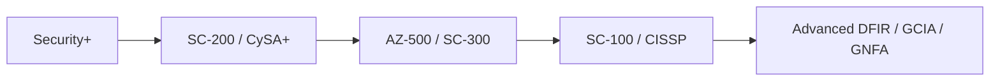

# 🧾 Certification Index

## Cybersecurity certifications for SOC, cloud, identity, and architecture

---

## Beginner

### 1) ISC2 CC
- Overview: entry-level cybersecurity foundation
- Skills covered: security principles, networking, risk, access control
- Exam details: 100 questions, multiple choice, no prerequisite
- Study plan: 4–6 weeks
- Free resources: official study guides, labs, practice quizzes
- Labs: basic networking and IAM scenarios
- Projects: mini security baseline checklist

### 2) CompTIA Security+
- Overview: broad foundational certification
- Skills covered: threats, attacks, architecture, identity, cryptography
- Exam details: SY0-701 style study path
- Study plan: 6–8 weeks
- Free resources: official training, practice tests, GitHub study notes
- Labs: file integrity, SIEM basics, secure configuration demos
- Projects: define a small enterprise security baseline

---

## SOC Analyst

### 3) Microsoft SC-200
- Overview: security operations analyst
- Skills covered: incident response, hunting, detection, Sentinel, Defender
- Exam details: M365 security operations focus
- Study plan: 8–10 weeks
- Free resources: Microsoft Learn, lab guides, KQL examples
- Labs: alert investigation, incident queue, KQL hunting
- Projects: build a small SOC case workflow

### 4) CompTIA CySA+
- Overview: behavioral analytics and threat detection
- Skills covered: threat hunting, analysis, vulnerability management, incident response
- Exam details: includes scenario-based analysis
- Study plan: 8–12 weeks
- Free resources: official resources, labs, threat hunting scenarios
- Labs: security event investigations and malware triage
- Projects: triage and detection tuning report

---

## Cloud Security

### 5) Microsoft AZ-500
- Overview: Azure security engineering
- Skills covered: identity, networking, workloads, threat protection
- Exam details: Azure security focus
- Study plan: 8–12 weeks
- Free resources: Azure Learn, labs, architecture examples
- Labs: Defender for Cloud, Key Vault, NSGs, IAM strategies
- Projects: design secure Azure landing zone

### 6) AWS Security Specialty
- Overview: AWS security services and controls
- Skills covered: IAM, KMS, logging, incident response, network security
- Exam details: AWS specialty exam
- Study plan: 10–12 weeks
- Free resources: AWS Skill Builder, workshops, whitepapers
- Labs: IAM policy analysis, CloudTrail, GuardDuty, Security Hub
- Projects: AWS secure architecture review

---

## Identity

### 7) Microsoft SC-300
- Overview: identity and access administrator
- Skills covered: Entra ID, conditional access, PAM, synchronization, identity governance
- Exam details: identity architecture and admin focus
- Study plan: 6–10 weeks
- Free resources: Microsoft Learn, hands-on labs
- Labs: conditional access, MFA, identity governance
- Projects: enterprise identity modernization plan

---

## Architect

### 8) Microsoft SC-100
- Overview: cyber security architect
- Skills covered: architecture, design, governance, security operations integration
- Exam details: architecture and design focus
- Study plan: 10–14 weeks
- Free resources: Microsoft Learn, architecture guidance, case studies
- Labs: secure architecture reviews, control mapping
- Projects: security architecture blueprint for an enterprise

### 9) CISSP
- Overview: advanced information security leadership certification
- Skills covered: governance, risk, architecture, security operations, asset security
- Exam details: broad, advanced security domains
- Study plan: 12–16 weeks
- Free resources: official content, community guides, quiz banks
- Labs: policy design, risk assessments, architecture control mapping
- Projects: enterprise security strategy document

---

## Advanced Defensive Certifications

### 10) GCIH
- Overview: incident handling and response
- Skills covered: incident response, malware, forensics, response procedures
- Exam details: defensive incident-handling emphasis
- Study plan: 8–10 weeks
- Free resources: SANS/official references, labs, practical exercises
- Labs: malware triage, host response, timeline reconstruction
- Projects: incident response playbook and report

### 11) GCFA
- Overview: forensic analysis
- Skills covered: digital forensics, memory, disk, timeline analysis
- Exam details: forensic investigation path
- Study plan: 10–12 weeks
- Free resources: digital forensics labs, SANS material, case studies
- Labs: disk image analysis and timeline reconstruction
- Projects: DFIR case summary

### 12) GCIA
- Overview: intrusion analysis
- Skills covered: network security monitoring, IDS/IPS, packet analysis
- Exam details: detection and threat analysis work
- Study plan: 8–10 weeks
- Free resources: packet analysis labs, Snort/Suricata tutorials
- Labs: traffic review and malicious session analysis
- Projects: suspicious traffic summary and detection notes

### 13) GNFA
- Overview: network forensic analysis
- Skills covered: deep packet inspection, network evidence, forensic workflows
- Exam details: advanced network forensic assessment
- Study plan: 10–12 weeks
- Free resources: network forensics references, lab guides
- Labs: PCAP evaluation and malicious communication review
- Projects: network forensic investigation package

---

## Certification comparison matrix

| Certification | Level | Best for | Focus |
|---|---|---|---|
| ISC2 CC | Beginner | Entry-level professionals | Core security fundamentals |
| Security+ | Beginner | Broad foundation | Security basics and operations |
| SC-200 | SOC | Analysts | Defender and Sentinel operations |
| CySA+ | SOC | Analysts | Threat detection and response |
| AZ-500 | Cloud | Azure defenders | Azure security engineering |
| AWS Specialty | Cloud | AWS teams | Cloud security operations |
| SC-300 | Identity | IAM and Entra admins | Identity and access |
| SC-100 | Architect | Security architects | Governance and design |
| CISSP | Architect | Senior security leaders | Broad enterprise security |
| GCIH/GCFA/GCIA/GNFA | Advanced | DFIR and analysis | Incident handling and forensics |

---

## Study strategy

- Learn fundamentals before vendor-specific tracks.
- Pair certification study with lab practice.
- Keep a detection journal and architecture notes.
- Map each skill to real SOC workflows.
- Prefer hands-on evidence over passive reading.

---

## Quick roadmap

---

## Final note

Certifications help validate your skill set, but the strongest profile comes from combining proof of work, labs, structured notes, and demonstrable incident-handling ability.
