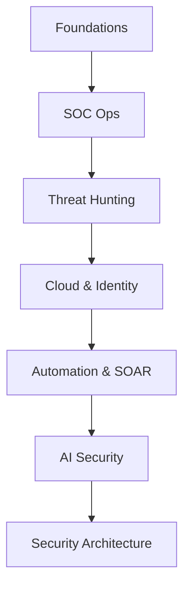
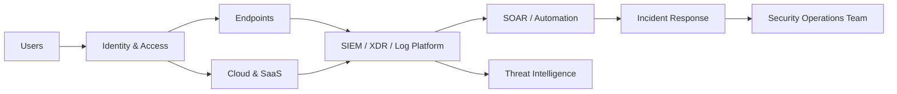

# 🛡️ Ultimate SOC Analyst to Security Architect Roadmap

## Premium Cyber Security Learning Portal

> A complete, practical cyber defense learning platform covering SOC operations, blue team workflows, threat hunting, cloud security, identity protection, AI security, automation, and architecture.

---

## Executive summary

This project evolves from a simple roadmap into a full knowledge platform for modern defenders. It connects fundamentals with operational execution and architectural design so learners can advance from basic security understanding to real-world defensive engineering.

---

## Navigation

- [Home](index.md)
- [Certification Index](certifications.md)
- [SOC Lab Index](labs.md)
- [Main README](../README.md)
- [Core Roadmap](../ROADMAP/SOC-OPERATIONS.md)

---

## Learning paths

| Path | Audience | Outcome |
|---|---|---|
| Foundations | Beginners | Understand networking, OS, security basics |
| SOC Operations | Analysts | Triage alerts, investigate incidents, evaluate telemetry |
| Detection & Hunting | Hunters | Build hypotheses, map to ATT&CK, improve detections |
| Cloud & Identity | Engineers | Defend Azure/AWS/GCP and identity platforms |
| Automation & AI | Defenders | Use SOAR, playbooks, and safe AI augmentation |
| Architecture | Leads | Design resilient, zero-trust, multi-layer defenses |

---

## Architecture blueprint

---

## Core skill domains

- Network fundamentals and segmentation
- Windows and Linux operating systems
- Security controls and risk management
- MITRE ATT&CK and adversary analysis
- Threat intelligence lifecycle and IOCs
- Cloud, identity, and zero-trust design
- AI security risks and governance
- SOAR playbooks and workflow automation
- SOC architecture and enterprise defense design

---

## Recommended study flow

1. Start with networking, OS, and security fundamentals.
2. Learn attack types, ATT&CK, and adversary behavior.
3. Practice alert triage and investigation workflows.
4. Move into hunting, cloud security, and identity protection.
5. Add AI security, automation, and architecture thinking.
6. Validate skills with labs, projects, and certifications.

---

## Certification focus

- ISC2 CC
- CompTIA Security+
- SC-200
- CySA+
- AZ-500 / AWS Security Specialty
- SC-300
- SC-100 / CISSP
- GCIH / GCFA / GCIA / GNFA

See the full [Certification Index](certifications.md).

---

## Hands-on lab emphasis

The repository supports training across:

- Defender lab
- Sentinel lab
- Splunk lab
- Sysmon lab
- Sigma lab
- Threat hunting lab
- Threat intelligence lab
- Cloud security lab
- SOAR lab
- AI security lab

See the [SOC Lab Index](labs.md) for objectives, tools, setup, attack simulation, investigation steps, and report templates.

---

## Final goal

The journey ends with defenders who can not only investigate alerts, but also design and improve resilient security systems, detect adversary tradecraft, and support enterprise governance.

---

<strong>From fundamentals to architecture — built for modern blue team excellence.</strong>

