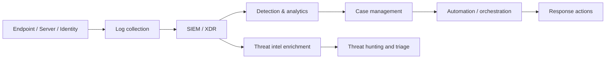

# 🧪 SOC Lab Index

## Defensive lab portfolio for SOC analysts, hunters, and security engineers

<div align="center">

[](index.md)
[](index.md)
[](index.md)
[](index.md)

</div>

---

## Lab catalog

| Lab | Objective | Tools Needed | Primary Outcome |
|---|---|---|---|
| Home SOC | Build a minimal SOC environment | Windows/Linux, SIEM, EDR | Understand telemetry and visibility |
| Defender Lab | Practice MDE and Defender workflows | Microsoft Defender, Sentinel | Investigate endpoint and identity events |
| Sentinel Lab | Build SIEM detections | Sentinel, KQL, connectors | Create and validate detection rules |
| Splunk Lab | Create searches and dashboards | Splunk | Investigate logs and perform investigations |
| Sysmon Lab | Use endpoint telemetry | Sysmon, Winlogbeat, Splunk/Sentinel | Understand process and system events |
| Sigma Lab | Translate detections to Sigma | Sigma, Splunk, Defender | Standardize rules |
| SOC Analyst Lab | Alert triage and case handling | SIEM, ticketing, EDR | Response workflow and evidence handling |
| Threat Hunting Lab | Hypothesis-driven hunting | Defender, Sentinel, Splunk | Search for suspicious patterns |
| Threat Intelligence Lab | IOCs and enrichment | MISP, VirusTotal, ThreatFox | Collect and validate indicators |
| DFIR Lab | Host-based investigation | Velociraptor, forensic tools | Timeline and artifact analysis |
| Malware Analysis Lab | Static and dynamic review | REMnux, sandbox | Identify malicious artifacts |
| Purple Team Lab | Validation of defenses | Caldera, C2, detection tools | Gap analysis and tuning |
| Cloud Security Lab | AWS/Azure security review | Defender for Cloud, CloudTrail, IAM | Cloud event review |
| AI Security Lab | LLM prompt and model risk review | Prompt testing environment | Understand AI abuse scenarios |
| SOAR Lab | Automate response flows | Logic Apps, XSOAR, TheHive | Orchestrate case response |

---

## Standard lab architecture



---

## Standard lab workflow

1. Define objective and scope.
2. Deploy telemetry sources.
3. Simulate realistic attack activity.
4. Collect logs and validate coverage.
5. Investigate evidence and interpret alerts.
6. Build detection logic and tuning notes.
7. Capture lessons learned in a report.

---

## Report template

```markdown
# Incident or Lab Report

## Title
- Lab Name:
- Date:
- Analyst:
- Scope:

## Objective
Describe the goal of the exercise.

## Architecture Diagram
Provide the environment diagram and telemetry flow.

## Attack Simulation
- Initial access vector:
- Persistence method:
- Lateral movement path:
- Exfiltration indicator:

## Detection Coverage
- Detection rule(s):
- Source(s):
- Coverage status:

## Investigation Steps
1. Validate alert context and user impact.
2. Review endpoint, identity, and network logs.
3. Correlate with threat intel and asset context.
4. Determine initial root cause and escalation path.

## Findings
- What was observed:
- Why it matters:
- What evidence supports it:

## Recommended Actions
- Detection improvement:
- Preventive control:
- Response measure:

## Lessons Learned
Summarize gaps, improvements, and follow-up actions.
```

---

## Example lab detail: Defender Lab

### Objective
Assess endpoint security telemetry and investigate a suspicious execution chain.

### Tools needed
- Microsoft Defender for Endpoint
- Defender XDR
- Sentinel or Log Analytics
- Sysmon

### Setup guide
- Configure endpoint visibility
- Enable audit and telemetry collection
- Validate device onboarding
- Build a sample incident scope

### Attack simulation
- Execute a suspicious script or payload in a controlled environment
- Trigger user logon anomalies
- Simulate reconnaissance or lateral movement patterns

### Detection guide
- Search for process creation events
- Review PowerShell command-line activity
- Correlate with user risk and device health

### Investigation steps
1. Validate the alert and time window
2. Review process lineage and parent-child execution
3. Check authentication and endpoint telemetry
4. Compare with threat intel and known suspicious indicators
5. Document detection gaps and next actions

---

## Lab matrix

| Lab | Objective | Attack Simulation | Detection Style |
|---|---|---|---|
| Defender Lab | Endpoint investigation | Suspicious execution | EDR and XDR |
| Sentinel Lab | Query and detection validation | Log correlation | SIEM |
| Splunk Lab | Search generation | User and system anomalies | Search and dashboard |
| Sysmon Lab | Process visibility | Suspicious binary execution | Endpoint telemetry |
| Sigma Lab | Rule translation | Adversary technique simulation | Detection engineering |
| Threat Hunting Lab | Hypothesis-driven queries | Behavioral threat hunting | Hunt-based analytics |
| SOAR Lab | Response workflow | Automated triage | Orchestration |

---

## Final note

Every lab should produce evidence-based investigation notes and a formal report. This is how defenders turn hands-on exercises into real operational skills.
